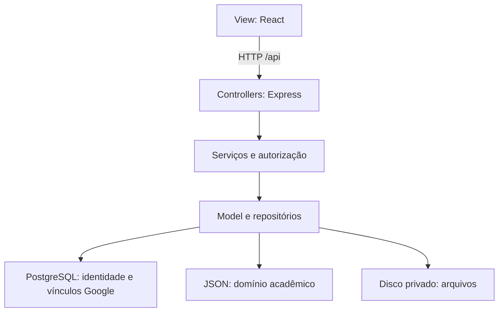

# Labrary Digital

[](https://github.com/henriquemantovan/Labrary-Digital-PCS-3643/actions/workflows/ci.yml)
[](docs/revisao-final.md#verificações-da-base)
[](docs/revisao-final.md#verificações-da-base)

Plataforma de gestão, avaliação e divulgação de projetos acadêmicos de sistemas digitais. Reúne vídeo, relatório, manual, feedback privado, submissões versionadas, avaliação por rubrica e liberação de resultados.

Projeto de **PCS3643 — Laboratório de Engenharia de Software I**. Esta revisão documental descreve a base `c2dbb7f` (merge do PR #58), conferida em 25/11/2026. Os badges de cobertura são valores estáticos dessa validação, não medições contínuas desta branch.

## 1. Tema e escopo

O tema é uma adaptação de plataforma de conteúdo digital para projetos acadêmicos. **Não há aprovação do professor registrada no repositório para a adaptação ou para a dispensa de requisitos originais.** Consulte o [registro acadêmico](docs/escopo-academico.md) e a [matriz de critérios e pendências](docs/revisao-final.md).

| Área | Estado do código na base revisada |
| --- | --- |
| Autenticação e perfis | Login local ou Google, sessão, permissões por turma/grupo e administração de papéis |
| Grupos e projetos | Cadastro docente, integrantes, atribuição de avaliadores e auditoria de vínculos |
| Requisitos e rubricas | Versões por projeto, três materiais obrigatórios, prazos e pesos dos critérios |
| Materiais | Upload real, histórico de versões, checksum e download protegido |
| Submissão | Checklist, snapshot da rubrica/materiais, bloqueios, devolução e reabertura |
| Acompanhamento e feedback | Busca/filtros privados e conversa vinculada às versões |
| Avaliações e notas | Rascunho, finalização, reabertura, consolidação, CSV e liberação ao grupo integrados |
| Publicação e acervo | Serviço, API e interface existem; finalização/publicação indisponíveis no servidor normal por falta de conexão dos provedores reais C1/C3 |
| Interface | Página inicial pública, login, quadro de projetos, turmas, perfil, notas e acervo; redesign do PR #58 integrado |
| Complementos | Histórico de consumo, vistos, favoritos, recomendações e estatísticas ainda no backlog |

Assinaturas individual/familiar, quatro acessos, restrição etária, receita e custos não foram implementados. Rubrica docente e feedback privado não equivalem automaticamente à avaliação pública exigida no enunciado. As dispensas precisam de decisão explícita do professor.

## 2. Sistema e equipe

**Sistema:** Labrary Digital (lab + library). **Grupo:** Equipe Labrary Digital, nome proposto; número acadêmico a confirmar.

| Integrante | GitHub | Área principal |
| --- | --- | --- |
| Henrique Mantovan | [henriquemantovan](https://github.com/henriquemantovan) | Integração, arquitetura, acesso e publicação |
| Enzo Pimentel | [enplo](https://github.com/enplo) | Materiais, submissão e backup |
| Dan Kiyochi | [kiyochii](https://github.com/kiyochii) | Acompanhamento, feedback, resultado e acervo |
| Yuhang | [yuhangf2333](https://github.com/yuhangf2333) | Rubricas, avaliação e redesign da interface |
| Kauê Barbosa | [kauebmr](https://github.com/kauebmr) | Consolidação, CSV, testes e instalação |

A divisão detalhada e o planejamento estão em [responsabilidades e sprints](docs/planejamento.md). O compartilhamento com `higoramario` e a adequação do nome do repositório ao padrão solicitado precisam ser confirmados pela equipe; não foram presumidos nesta revisão.

## 3. Crazy 8 e protótipos

As [fotografias, autores, três ideias escolhidas e justificativas](docs/crazy8/README.md) estão registradas. Há folhas com menos de oito ideias e validação de protótipos ainda sem registro de conclusão. As [telas desktop](docs/prototipos) e suas [versões mobile](docs/prototipos/mobile) documentam o protótipo; não são capturas da interface atual.

## 4. Histórias de usuários

As [HU01–HU14, critérios e definição de Done](docs/historias-de-usuario.md) permanecem rastreáveis às issues. Código integrado, testes passando e história aceita são estados diferentes. A [revisão final](docs/revisao-final.md) identifica os incrementos existentes e as pendências de aceite.

## 5. Instalação e execução

Requer **Node.js 24.19.0** e **pnpm 11.25.0**. A instalação detalhada, inclusive preparação de uma máquina Linux nova, está em [instalação e aceitação](docs/instalacao-e-aceitacao.md). O requisito acadêmico é Ubuntu **26.04**; o CI usa **24.04**, e a validação limpa na distribuição exigida continua pendente.

Após preparar Git, Node e pnpm:

```sh
git clone https://github.com/henriquemantovan/Labrary-Digital-PCS-3643.git
cd Labrary-Digital-PCS-3643
git switch revisao-final
node --version
pnpm --version
pnpm install --frozen-lockfile
pnpm build
pnpm demo
```

`pnpm demo` inicia frontend/API com dados locais isolados, sem PostgreSQL nem credenciais Google. Abra **http://localhost:5173/login**. A página inicial fica em `/`, projetos em `/projetos`, turmas em `/turmas`, notas em `/notas`, perfil em `/perfil` e acervo em `/acervo`.

| Conta de demonstração | Papel | Senha |
| --- | --- | --- |
| `aluno@labrary.local` | Aluno do Grupo 02 | `Labrary@2026` |
| `avaliador@labrary.local` | Avaliador inicialmente atribuído ao projeto 1 | `Labrary@2026` |
| `professor@labrary.local` | Professora da turma 1 | `Labrary@2026` |

Essas contas são apenas locais. A demonstração padrão não inclui uma conta ADMIN. O [manual de uso](docs/manual-de-uso.md) explica a preparação dos vínculos e o fluxo completo de avaliação.

Para desenvolvimento com configuração persistente, copie `.env.example` para `.env` **apenas se ainda não existir**, ajuste as variáveis e execute `pnpm dev`. Para Google/PostgreSQL, siga [SSO e migrations](docs/login-google.md); usuários, papéis e turmas precisam ser provisionados conforme o guia. Não reutilize dados da demonstração em contas reais.

## 6. Testes, CI e evidências

```sh
pnpm build
pnpm test
pnpm exec playwright install --with-deps chromium
pnpm test:e2e
```

- Vitest/Supertest: unidade e integração da API; Testing Library/jsdom: interação da interface.
- Cobertura mínima de **85% em statements, branches, funções e linhas**, separadamente para API e web.
- Playwright: Chromium desktop e emulação mobile, com servidores e dados de teste isolados.
- O enunciado não fixa quantidade mínima de testes; exige tipos de teste, cobertura e **ao menos cinco vídeos de funcionalidades diferentes**.
- `pnpm test:e2e` executa as suítes geral, submissão, notas (um perfil por processo) e avaliação.
- O [workflow](.github/workflows/ci.yml) instala dependências, compila, testa cobertura, testa PostgreSQL/migrations e executa E2E; publica cobertura e resultados como artefatos.
- Testes locais e CI não comprovam login com Google real ou instalação no Ubuntu 26.04.

A [última validação da base](docs/revisao-final.md#verificações-da-base) registra 277 testes API, 127 web e 54 cenários E2E aprovados. Esta branch altera somente documentação e não declara uma nova execução dessas suítes. As [gravações de Dan](docs/dan-semana7.md) distinguem fluxos reais de pré-requisitos de publicação simulados. A seleção final dos cinco vídeos permanece em revisão.

`pnpm db:test` exige um PostgreSQL descartável com permissão CREATEDB; veja [instalação e aceitação](docs/instalacao-e-aceitacao.md). Não o execute contra infraestrutura de produção.

## 7. Tecnologias

| Camada | Tecnologias e versões diretas principais |
| --- | --- |
| Runtime e pacotes | Node 24.19.0; pnpm 11.25.0; TypeScript 5.9.3 |
| Interface | React/React DOM 19.3.1; Vite 8.3.4; Tailwind 4.3.5; Base UI 1.9.0; componentes coss ui copiados para `components/ui`; Lucide 1.73.0 |
| API | Express 5.3.0; Zod 4.6.7; busboy 1.6.0; jose 6.2.14 |
| Dados | PostgreSQL (CI: imagem 18), pg 8.23.1; Prisma 7.10.0 para schema/migrations; JSON e volume privado para o domínio acadêmico |
| Testes | Vitest/coverage-v8 5.0.5; Supertest 7.3.1; Testing Library React 16.3.0; Playwright 1.56.1 |

Todas as dependências diretas e transitivas estão nos manifests da [raiz](package.json), [API](packages/api/package.json), [web](packages/web/package.json) e no [lockfile](pnpm-lock.yaml). Use instalação congelada. Não há Docker Compose ou script de lint versionado nesta base.

## 8. Arquitetura e diagramas

A implementação usa View React, controllers/rotas Express, serviços de domínio e repositórios. **A persistência é híbrida**: PostgreSQL para identidades/sessões/vínculos no modo Google, JSON privado para projetos, rubricas, avaliações e liberações, e disco privado para os arquivos enviados. A API usa consultas `pg`; a existência do model Prisma não significa que todo o domínio seja persistido pelo Prisma.



- [Arquitetura e componentes atuais](docs/arquitetura.md).
- [Classes e tipos do domínio implementado](docs/diagrama-classes.md).
- [DER físico ativo e relações lógicas](docs/diagrama-er.md).
- [Sequências de autenticação, submissão, avaliação e publicação](docs/diagramas-sequencia.md).
- [Estados do projeto e publicação](docs/estados-do-projeto.md).
- [Contratos REST](docs/api-inicial.md) e [contratos C0–C4](docs/contratos).

O [SQL inicial](db/schema.sql) e o [schema Prisma](packages/api/prisma/schema.prisma) incluem o modelo relacional alvo. Instalações novas usam `pnpm db:deploy`; não reaplique o SQL histórico em banco já migrado. Backup completo inclui JSON, uploads e PostgreSQL quando utilizado.

## 9. Entrega e rastreabilidade

| Documento | Finalidade |
| --- | --- |
| [Manual de uso](docs/manual-de-uso.md) | Passos por perfil e roteiro de demonstração |
| [Instalação e aceitação](docs/instalacao-e-aceitacao.md) | Ambiente, banco, seed, backup, testes e evidências |
| [Revisão final](docs/revisao-final.md) | Matriz de requisitos, verificações e pendências por responsável |
| [Escopo acadêmico](docs/escopo-academico.md) | Decisões do professor ainda necessárias |
| [Planejamento](docs/planejamento.md) | Responsabilidades, backlog e histórico de sprints |
| [Uso de IA](docs/desenvolvimento-com-ia.md) | Orientações e registro dos prompts conhecidos |

A apresentação final está prevista para **26/11/2026**. Não há declaração de aceite integral: faltam integração real de publicação, comprovação do ambiente exigido, revisão das evidências e decisões acadêmicas. A atualização desta branch não fecha issues nem altera o código da aplicação.
