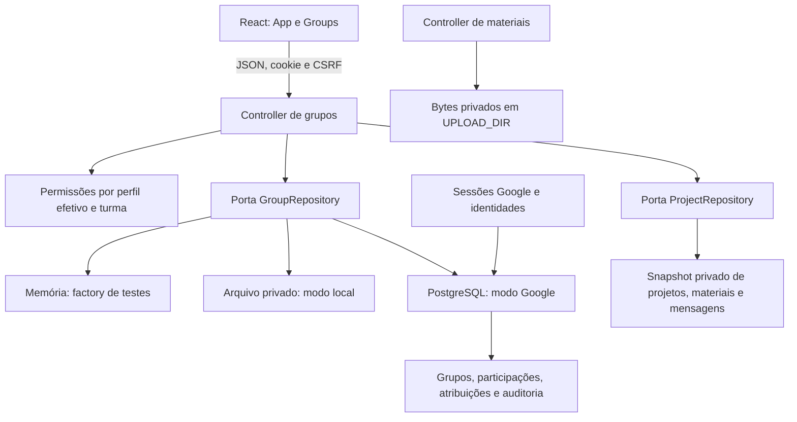

# Revisão de arquitetura — semana 5 (#16/#32)

Revisão local de 07/11/2026. O modelo completo no DER continua sendo alvo do MVP; tabelas existentes não comprovam que haja adapter de produção para todas as histórias.

A View não escolhe o papel, o autor da ação nem a turma autorizada. O middleware autentica e recarrega o diretório Google; o controller valida entrada e escopo. `GroupRepository` coordena a escrita dos vínculos e do histórico. No PostgreSQL, a transação revalida autoridade, bloqueia a turma e grava a auditoria antes do commit. No arquivo, gravação precede a atualização da memória; o processo é único. Filtros e seleção de contas nunca ampliam o escopo do professor.

| Informação | Persistência de produção atual |
| --- | --- |
| Identidades, perfis, sessões e tentativas Google | PostgreSQL |
| Grupos e vínculos Google; histórico | PostgreSQL; nova migration da HU02 |
| Grupos, vínculos e histórico locais | Arquivo privado separado, vinculado aos IDs do diretório |
| Projetos, versões de metadados e mensagens | Arquivo privado HU07 |
| Conteúdo dos materiais | Disco privado HU04; autorização em cada download |
| Requisitos/rubricas, submissão, avaliação e publicação | Incrementos separados; não presumir integração pelas tabelas do schema |

A atribuição de avaliador referencia o ID do projeto efetivo no arquivo. A decisão transitória sobre sua FK e a futura reconciliação estão na [HU02](hu02.md). `ProjectRepository` continua sendo a porta para resolver projeto/turma; não há réplica automática em duas fontes. Preservar banco, snapshots e bytes como conjunto consistente no backup.

A composição com o PR #26 está descrita na [HU02](hu02.md). O [C4](contratos/c4-publicacao.md) define a projeção pública estrita e a futura porta do catálogo, separada dos DTOs privados. A S5 não cria endpoints de publicação nem declara os adapters C0–C3 concluídos. Revisão de outro integrante, aceite e publicação remota das evidências permanecem pendentes.

## Evolução S6 — publicação

A [HU11](hu11.md) acrescenta um serviço de publicação com portas para C1/C3, histórico de decisões no mesmo snapshot de projetos, projeção pública explícita e leitura autorizada de bytes/Range. O entrypoint conserva as ações desabilitadas enquanto as integrações reais faltarem; o catálogo usa as novas rotas HTTP sem fallback de fixtures. O diagnóstico da S5 acima permanece como registro daquela entrega.
