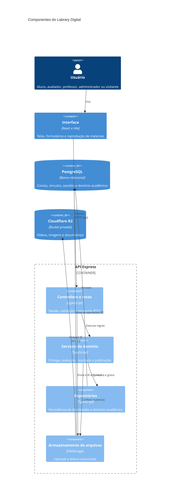

# Arquitetura

O sistema é um monorepo pnpm com interface React/Vite e API Express/TypeScript. A interface chama `/api` na mesma origem; controllers validam requisições, serviços aplicam regras e repositórios acessam os dados.

## Componentes MVC — modelo C4

## Persistência

| Informação | Armazenamento no ambiente fornecido |
| --- | --- |
| Identidades, dados acadêmicos do usuário, vínculos, auditoria, convites e sessões Google | PostgreSQL, tabelas relacionais |
| Projetos, versões de materiais, mensagens, submissões e publicações | PostgreSQL, `academic_state` (`domain=projects`) |
| Requisitos e critérios de avaliação | PostgreSQL, `academic_state` (`domain=rubrics`) |
| Avaliações | PostgreSQL, `academic_state` (`domain=evaluations`) |
| Liberações de resultado | PostgreSQL, `academic_state` (`domain=results`) |
| Controle de uso do R2 | PostgreSQL, `r2_usage` |
| Arquivos enviados | Bucket R2 privado |

`academic_state` preserva os agregados versionados em colunas JSONB nativas do PostgreSQL. Não há arquivos JSON locais no caminho de persistência do modo Google. Os adapters recarregam o estado a cada operação, bloqueiam a linha durante a alteração e só retornam sucesso após COMMIT. IDs, versões e idempotência são protegidos contra escritas concorrentes entre instâncias. A reserva das operações R2 usa UPDATE atômico e é confirmada antes da chamada remota.

Os agregados não foram normalizados nas tabelas acadêmicas históricas; suas referências internas continuam validadas pela aplicação. O bloqueio é por agregado, e o estado inteiro é carregado por operação: grandes volumes podem exigir particionamento ou normalização. Não existe transação única entre os vários serviços de domínio e o R2. O limite de capacidade do bucket serializa uploads nesta instância; mantenha uma instância responsável pelos envios se depender dessa margem de capacidade.

A factory de testes aceita repositórios em memória. O demo isolado, sem serviços externos, conserva adapters de arquivo e sessões em memória. Esses adapters não são usados pelo ambiente Google/PostgreSQL entregue.

A migração adiciona `academic_state`, `academic_data_import` e `r2_usage`. A importação legada é explícita por `pnpm db:importar-json`, cria cópias privadas e recusa sobrescrever dados divergentes. O hash da origem permite repetir o comando sem reverter alterações posteriores. Contadores R2 nunca são reduzidos pela importação. Consulte o [DER](diagrama-er.md) e o [procedimento de backup](instalacao-e-aceitacao.md#backup-e-restauração).

## Autorização e privacidade

A API usa sessão em cookie HttpOnly e verifica origem e proteção CSRF nas alterações. Papéis e vínculos são conferidos no servidor: aluno acessa os próprios grupos; avaliador, os projetos atribuídos; professor, suas turmas. O administrador em prévia usa os vínculos da própria conta.

Uma submissão conserva as versões dos materiais e dos critérios de avaliação. A avaliação pertence à rodada submetida. Reabrir ou alterar a avaliação invalida a liberação anterior do resultado. Finalizar o projeto não publica os materiais; a publicação exige seleção e autorização próprias.

O catálogo expõe somente publicações ativas e os materiais selecionados. Notas, feedback, integrantes e chaves de armazenamento continuam privados. A retirada bloqueia novas consultas e leituras públicas, incluindo HEAD e Range; arquivos já recebidos pelo visitante não podem ser recolhidos.

## Armazenamento de arquivos

Com `STORAGE_PROVIDER=r2`, os bytes ficam em um bucket privado. Upload, download e reprodução passam pela API; o navegador não recebe credenciais ou chaves do bucket. O envio utiliza temporário limitado para conferir formato, tamanho e SHA-256 antes da gravação definitiva. O player suporta uma faixa Range por requisição, sem transcodificação ou qualidade adaptativa.

Com `STORAGE_PROVIDER=disk`, os materiais ficam em `UPLOAD_DIR`. A troca de provedor não migra arquivos existentes: copie os objetos pelas mesmas chaves e confira tamanho/checksum antes da mudança.

Para uma configuração nova, use bucket R2 **Standard** privado e credenciais restritas a ele. Preencha `R2_ACCOUNT_ID`, `R2_BUCKET`, `R2_ACCESS_KEY_ID` e `R2_SECRET_ACCESS_KEY` no `.env`. Não exponha acesso público nem variáveis com segredo ao frontend.

O controle da API limita o bucket a 9.000.000.000 bytes e reserva até 100.000 operações A e 1.000.000 B por mês UTC. As reservas são persistidas no PostgreSQL antes das chamadas remotas. O controle deve ser conservado entre reinícios e não mede uso externo da conta. A [franquia e cobrança do R2](https://developers.cloudflare.com/r2/pricing/) pertencem ao provedor; os limites da aplicação não garantem custo zero absoluto.

## Testes e recursos de demonstração

Os testes unitários e de navegador usam dados isolados. `pnpm demo` força armazenamento em disco temporário; `pnpm dev` utiliza o `.env` fornecido. As oito contas fictícias são permitidas somente em desenvolvimento local explicitamente habilitado, com as mesmas regras de acesso do ambiente configurado.

Os JSON em `docs/contratos/` são exemplos consumidos por testes e componentes de demonstração. Eles não substituem os dados reais da aplicação. Consulte a [API REST](api-inicial.md) e os [comandos de teste](../README.md#testes).
