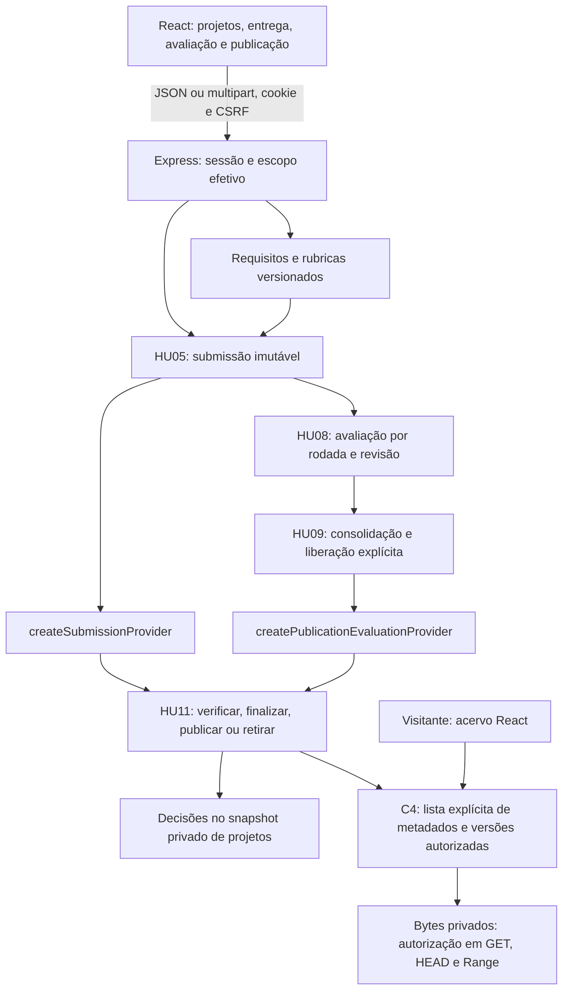

# Arquitetura integrada — revisão de 25/11/2026

Arquitetura executável da aplicação. O DER descreve também funcionalidades planejadas; esta página identifica os componentes conectados, as fronteiras de autorização e a persistência efetiva.



## Interface e implantação

`App.tsx` seleciona a página inicial pública, o acervo e a área autenticada. As telas ficam em `pages/`; `layout/AppShell.tsx` reúne a navegação. A interface usa componentes coss ui/Base UI, Lucide e tokens Tailwind de `index.css`. O cadastro USP pendente antecede a navegação privada; convites são administrados pelo ADMIN. O player privado usa sessão e Range e só carrega ao apertar Play.

Vite encaminha `/api` à API durante o desenvolvimento. Em produção, servir `packages/web/dist` com fallback de SPA e encaminhar `/api` à API na mesma origem; `NODE_ENV=production` exige `APP_ORIGIN` HTTPS. O build não publica nem inicia um servidor web de produção.

## Composição e fronteiras

`server.ts` abre os repositórios persistentes e os injeta em `createApp`. A factory mantém portas substituíveis para testes; não carrega dados de avaliação de exemplo por padrão. Com `evaluationRepository`, cria o serviço real de avaliação. Consolidação e publicação compartilham a mesma instância de `EvaluationProvider` e o mesmo repositório de liberações.

O adapter C1 consulta a última rodada persistida, inclusive quando devolvida; a HU11 recusa esse estado. O adapter C3 chama `consolidate`, reutilizando validação da rubrica, critérios e notas. Projeta apenas IDs e sinais de completude/liberação; não transporta notas ou comentários para a publicação. O fingerprint identifica uma liberação do resultado ao grupo; não constitui autorização de divulgação.

`publicationService` autentica o escopo docente, verifica a mesma rodada/rubrica e os avaliadores atuais, confere metadados e presença/tamanho dos arquivos e relê C1/C3 após as operações assíncronas. Só então grava a decisão. Uma reabertura concorrente não pode aproveitar a prontidão anterior. Depois de `FINALIZADO`, as rotas reais de avaliação e devolução recusam alterações da rodada. Ações da HU11 são serializadas por projeto dentro do processo; não há transação distribuída entre processos.

Controllers validam schemas, sessão e CSRF; serviços aplicam regras; repositórios gravam antes de atualizar o estado em memória. A View recebe permissões do backend. ADMIN em prévia usa o perfil e os vínculos efetivos; o autor das decisões HU11 é a conta real da sessão.

## Persistência efetiva

| Informação | Armazenamento e configuração |
| --- | --- |
| Projetos, materiais, versões, mensagens, rodadas C1, reaberturas e decisões HU11 | Snapshot privado `PROJECT_DATA_FILE` |
| Requisitos e rubricas históricas | `RUBRIC_DATA_FILE`, padrão `${PROJECT_DATA_FILE}.rubrics.json` |
| Avaliações e histórico de revisões C2 | `EVALUATION_DATA_FILE`, padrão `${PROJECT_DATA_FILE}.evaluations.json` |
| Decisões de liberação C3 | `RESULT_RELEASE_DATA_FILE`, padrão `${PROJECT_DATA_FILE}.results.json` |
| Conteúdo dos materiais | `STORAGE_PROVIDER=disk` usa `UPLOAD_DIR`; `r2` usa bucket privado Cloudflare R2. Bytes passam pela API |
| Contadores de operações R2 | Arquivo privado `R2_USAGE_FILE`, padrão `${PROJECT_DATA_FILE}.r2-usage.json`; preservar entre reinícios |
| Contas locais | Diretório JSON provisionado ou contas optativas de demonstração |
| Vínculos e auditoria locais | `GROUP_DATA_FILE`, padrão `${PROJECT_DATA_FILE}.groups.json` |
| Identidades, vínculos, auditoria, sessões e tentativas OAuth no modo Google | PostgreSQL; migrations anteriores preservadas |
| Cadastro acadêmico dos alunos e autorizações/histórico de convidados | PostgreSQL no modo Google; adapter em memória na factory/local |
| Sessões locais | Memória; novo login após reiniciar |

Os arquivos privados exigem um único escritor e disco persistente. O snapshot de finalização e o estado `FINALIZADO` são gravados juntos no arquivo de projetos. Avaliações e liberações estão em arquivos separados; para backup consistente, pare o escritor e conserve todo o conjunto, incluindo vínculos e bytes. Procedimento: [instalação e restauração](instalacao-e-aceitacao.md#backup-e-restauração-de-teste).

## Evolução da persistência de vídeos e imagens

Por padrão, os arquivos enviados ficam em `UPLOAD_DIR` (padrão `.uploads`), na máquina que executa a API. O armazenamento R2 é optativo e exige configuração explícita. O PostgreSQL guarda identidades e vínculos; os snapshots privados guardam os metadados dos materiais. Fazer backup apenas do banco não preserva os vídeos, imagens, projetos e avaliações. Os bytes são gravados por streaming, com limite de tamanho, SHA-256 e arquivo temporário antes da conclusão; não há conversão automática de qualidade de vídeo. Reiniciar a API com o mesmo disco conserva os arquivos, mas recriar uma hospedagem sem volume persistente pode perdê-los.

| Alternativa | Benefício e compromisso | Adequação ao projeto |
| --- | --- | --- |
| Volume persistente fora da pasta de implantação, com backup em outro local | Evita perder arquivos ao substituir a aplicação; exige espaço, monitoramento e restauração sob responsabilidade da equipe | Melhoria imediata com pouca mudança; permanece dependente do servidor |
| Armazenamento de objetos privado, como Amazon S3 ou Cloudflare R2 | Separa os arquivos da máquina da API; exige credenciais restritas, política de retenção e avaliação dos custos de armazenamento, operações e transferência | Recomendação para uma hospedagem duradoura; pode guardar vídeos, imagens e PDFs pelo mesmo contrato |
| Serviço de vídeo, como Cloudflare Stream | Armazena, codifica e entrega vídeo com qualidade adaptativa; exige integrar processamento, player e autorização próprios do serviço | Considerar quando a reprodução em conexões diferentes justificar a complexidade; imagens e PDFs precisam de outro armazenamento |

A recomendação acima é uma avaliação da arquitetura atual. O [R2 oferece API compatível com S3 e armazenamento replicado](https://developers.cloudflare.com/r2/how-r2-works/). O [Stream oferece armazenamento, codificação e reprodução adaptativa](https://developers.cloudflare.com/stream/); são serviços diferentes. Durabilidade do provedor não substitui proteção contra exclusão acidental nem uma política de backup e restauração. Nenhum serviço externo foi provisionado nesta alteração.

O adapter `r2Storage` implementa a porta `FileStorage` (`save`, `open` e `remove`), com as mesmas chaves UUID, limites, validação da assinatura do arquivo, SHA-256 e leitura parcial `Range`. O bucket deve ser privado e a API continua autorizando GET, HEAD e Range. Essa escolha preserva a retirada de publicação: uma [URL pré-assinada do S3 pode ser reutilizada até expirar](https://docs.aws.amazon.com/AmazonS3/latest/userguide/using-presigned-url.html), portanto retirar uma publicação na aplicação não invalida automaticamente um link já emitido. Um serviço de vídeo também exigiria configurar [acesso por tokens assinados](https://developers.cloudflare.com/stream/viewing-videos/securing-your-stream/) e definir explicitamente sua expiração e revogação.

Uma migração dos arquivos deve inventariar as chaves referenciadas, copiar os bytes, verificar tamanho e SHA-256 de cada objeto e testar upload, reprodução parcial, download privado e retirada pública. A troca final deve ocorrer com o escritor parado ou com uma estratégia explícita para os uploads concorrentes. Conservar a cópia anterior para retorno até validar a restauração. Uploads interrompidos e objetos sem metadados precisam de limpeza controlada; os metadados só devem confirmar um arquivo após sua gravação completa.

Mover os arquivos não elimina a exigência de um único escritor dos snapshots JSON. Para executar várias instâncias da API, seria necessário migrar também projetos, avaliações, rubricas e liberações para um armazenamento transacional compartilhado. Foi escolhido o armazenamento de objetos R2, sujeito à configuração privada e aos limites de orçamento descritos abaixo; não é necessário contratar processamento de vídeo para resolver apenas a persistência.

## Cloudflare R2 e controle da franquia gratuita

A opção escolhida é **Cloudflare R2 Standard**, com bucket privado. A [franquia publicada pela Cloudflare](https://developers.cloudflare.com/r2/pricing/) inclui 10 GB-mês, 1 milhão de operações A e 10 milhões B por mês; transferência de saída é gratuita. A franquia é da conta, compartilhada entre buckets, e não se aplica à classe Infrequent Access. Uso excedente é cobrado. **R2 não fornece, nessa configuração, uma garantia absoluta de custo zero: os limites abaixo pertencem à aplicação e não bloqueiam a cobrança da Cloudflare.** O [controle de gastos da Cloudflare](https://developers.cloudflare.com/billing/manage/spend-management/) oferece bloqueios para Workers e Durable Objects, que não incluem R2; alertas de orçamento apenas notificam e não interrompem o uso.

Para reduzir o risco, a integração limita este Labrary a **9.000.000.000 bytes no bucket**, **100.000 reservas A** e **1.000.000 reservas B por mês UTC**. Os valores têm margem abaixo da franquia. A capacidade é recalculada pela listagem paginada de todos os objetos antes de cada upload; uploads e remoções são serializados no único processo escritor. Isso inclui objetos sem metadados deixados por falhas, mas não mede outros buckets, uploads parciais criados por outras ferramentas ou alterações externas concorrentes.

Cada operação paga é reservada no disco antes da chamada remota, inclusive tentativas que falham. O SDK não repete operações automaticamente. Os contadores sobrevivem ao reinício e só são renovados no mês UTC seguinte; HEAD e verificações que não leem bytes podem reservar mais que o uso real. Uploads acima da capacidade recebem `507 STORAGE_CAPACITY_LIMIT`; esgotamento das operações recebe `503 STORAGE_OPERATION_LIMIT`. Falha remota recebe `503 STORAGE_UNAVAILABLE`. O acervo continua sujeito a esses limites, mesmo para visitantes.

O arquivo de uso ausente ou corrompido impede iniciar o modo R2. Não apague, recrie ou restaure uma cópia antiga desse arquivo para liberar cota: isso não reinicia o uso faturado pela Cloudflare. Não compartilhe bucket, credenciais ou franquia com outros sistemas. Não habilite acesso público, regras de migração para Infrequent Access, outros escritores ou serviços pagos; uso externo não é contabilizado pela aplicação. Se custo zero precisar de garantia contratual mesmo diante desses fatores, mantenha `STORAGE_PROVIDER=disk` até escolher um serviço com bloqueio de cobrança no provedor.

### Configurar uma conta e bucket novos

1. No painel **R2 Object Storage**, crie um bucket, por exemplo `labrary-materiais`, na classe **Standard**, sem jurisdição especial. Mantenha **Public Development URL (`r2.dev`) desabilitada** e não conecte domínio público. Os [buckets são privados por padrão](https://developers.cloudflare.com/r2/buckets/public-buckets/).
2. Em **Manage R2 API Tokens**, gere credenciais **Object Read & Write**, restritas apenas a esse bucket. Guarde **Access Key ID** e **Secret Access Key** no `.env` privado da API; não use variáveis `VITE_`, não envie pelo chat e não versione. O [guia de autenticação R2](https://developers.cloudflare.com/r2/api/tokens/) mostra onde obter esses valores e o Account ID.
3. Preencha a configuração abaixo. O endpoint S3 é derivado do Account ID; não é necessário contratar AWS ou criar um bucket público.

```dotenv
STORAGE_PROVIDER=r2
R2_ACCOUNT_ID=identificador_de_32_caracteres_hexadecimais
R2_BUCKET=labrary-materiais
R2_ACCESS_KEY_ID=preencher_no_ambiente_privado
R2_SECRET_ACCESS_KEY=preencher_no_ambiente_privado
# Opcional: caminho privado persistente; padrão junto do PROJECT_DATA_FILE.
# R2_USAGE_FILE=/caminho/privado/r2-usage.json
```

4. **Somente na primeira configuração de uma conta sem uso anterior no mês**, com a API parada, execute `pnpm storage:init`. O comando cria o controle local sem fazer chamadas à Cloudflare e recusa sobrescrever arquivo existente. Se a conta já teve uso, primeiro é necessário conciliar os contadores com o painel; não inicialize valores zerados como se a franquia estivesse intacta.
5. Antes de mudar uma instalação com arquivos antigos, copie-os preservando as chaves e verifique SHA-256 conforme o plano de migração acima. A troca de variável não copia `.uploads` nem altera referências dos materiais existentes. Não apague a cópia antiga antes do aceite e teste de restauração.
6. Inicie `pnpm dev` e valide upload, download privado, reprodução e retirada. Confira o painel de uso e mantenha os snapshots, o arquivo de uso e o PostgreSQL nos backups. `pnpm demo` e o E2E do entrypoint forçam disco e não usam o bucket real.

No modo R2, cada envio usa um arquivo temporário privado limitado ao tamanho da regra (e ao teto de 5 GB do upload simples) para calcular assinatura, tamanho e SHA-256 antes de transmitir. O temporário é removido no sucesso e nas falhas tratadas; a máquina da API ainda precisa de espaço temporário. Não há upload multipart remoto nem conversão de vídeo. Os metadados só confirmam a versão depois do envio completo. Leituras usam HEAD para o tamanho e GET sob demanda, com `If-Match` e Range; verificações de existência não baixam o vídeo inteiro.

Os testes do adapter exercitam bytes reais pelo SDK S3 contra um servidor HTTP local, além de cotas, reinício do contador, concorrência, isolamento e retirada pública. Isso não comprova a configuração de privacidade, credenciais, cobrança ou disponibilidade de uma conta Cloudflare real.

## Exposição pública

A listagem e o detalhe retornam somente uma decisão `PUBLICADO` ativa de um projeto `FINALIZADO`. O DTO C4 é construído campo a campo; a referência de consentimento permanece no histórico privado. O catálogo não recebe notas, mensagens, integrantes, rubrica, checksums ou chaves de armazenamento.

Cada abertura de bytes verifica a seleção autorizada e a publicação ativa, novamente após acessar o disco. A retirada revoga listagem, detalhe, GET, HEAD e novas requisições Range sem apagar os dados privados. Respostas usam `no-store`; bytes já recebidos e streams já iniciados não podem ser recolhidos. Veja [C4](contratos/c4-publicacao.md) e [limitações](limitacoes.md).

## Verificação e revisão

[publicationIntegration.test.ts](../packages/api/src/routes/publicationIntegration.test.ts) exercita C1/C2/C3/C4, reinício dos repositórios, isolamento, nova rodada e concorrência com arquivos reais. [publication-flow.spec.ts](../e2e/publication-flow.spec.ts) usa o entrypoint normal em desktop e celular emulado, sem provedores de submissão/avaliação simulados. Testes isolados com doubles continuam úteis, mas suas evidências ficam identificadas separadamente. Os comandos de verificação estão na [validação da entrega](../README.md#6-testes-ci-e-evidências); a aprovação dos fluxos depende da revisão da equipe.
