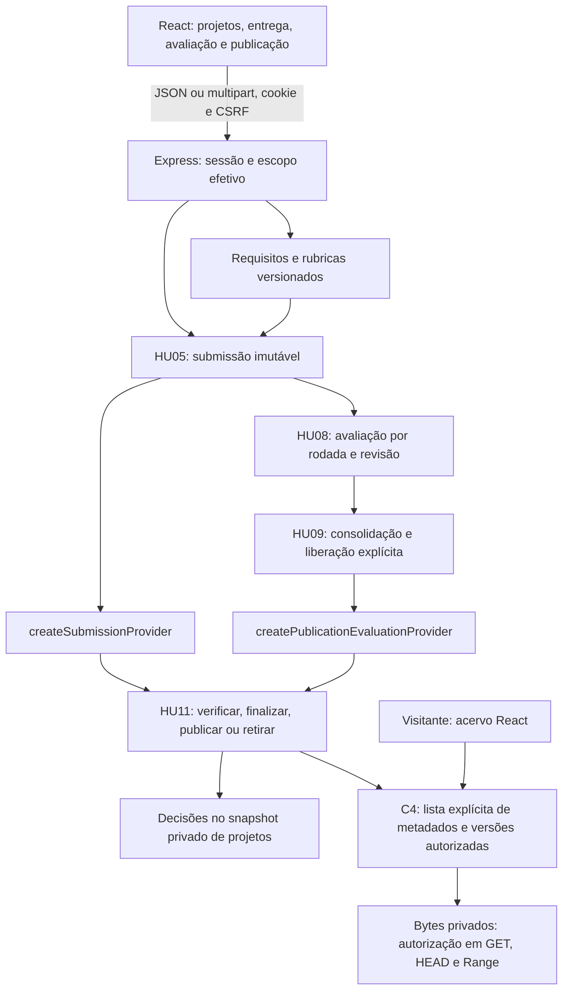

# Arquitetura integrada — semana 7

Arquitetura executável da aplicação. O DER descreve também funcionalidades planejadas; esta página identifica os componentes conectados, as fronteiras de autorização e a persistência efetiva.

## Composição e fronteiras

`server.ts` abre os repositórios persistentes e os injeta em `createApp`. A factory mantém portas substituíveis para testes; não carrega dados de avaliação de exemplo por padrão. Com `evaluationRepository`, cria o serviço real de avaliação. Consolidação e publicação compartilham a mesma instância de `EvaluationProvider` e o mesmo repositório de liberações.

O adapter C1 consulta a última rodada persistida, inclusive quando devolvida; a HU11 recusa esse estado. O adapter C3 chama `consolidate`, reutilizando validação da rubrica, critérios e notas. Projeta apenas IDs e sinais de completude/liberação; não transporta notas ou comentários para a publicação. O fingerprint identifica uma liberação do resultado ao grupo; não constitui autorização de divulgação.

`publicationService` autentica o escopo docente, verifica a mesma rodada/rubrica e os avaliadores atuais, confere metadados e presença/tamanho dos arquivos e relê C1/C3 após as operações assíncronas. Só então grava a decisão. Uma reabertura concorrente não pode aproveitar a prontidão anterior. Depois de `FINALIZADO`, as rotas reais de avaliação e devolução recusam alterações da rodada. Ações da HU11 são serializadas por projeto dentro do processo; não há transação distribuída entre processos.

Controllers validam schemas, sessão e CSRF; serviços aplicam regras; repositórios gravam antes de atualizar o estado em memória. A View recebe permissões do backend. ADMIN em prévia usa o perfil e os vínculos efetivos; o autor das decisões HU11 é a conta real da sessão.

## Persistência efetiva

| Informação | Armazenamento e configuração |
| --- | --- |
| Projetos, materiais, versões, mensagens, rodadas C1, reaberturas e decisões HU11 | Snapshot privado `PROJECT_DATA_FILE` |
| Requisitos e rubricas históricas | `RUBRIC_DATA_FILE`, padrão `${PROJECT_DATA_FILE}.rubrics.json` |
| Avaliações e histórico de revisões C2 | `EVALUATION_DATA_FILE`, padrão `${PROJECT_DATA_FILE}.evaluations.json` |
| Decisões de liberação C3 | `RESULT_RELEASE_DATA_FILE`, padrão `${PROJECT_DATA_FILE}.results.json` |
| Conteúdo dos materiais | Disco privado `UPLOAD_DIR`; nunca servido estaticamente |
| Contas locais | Diretório JSON provisionado ou contas optativas de demonstração |
| Vínculos e auditoria locais | `GROUP_DATA_FILE`, padrão `${PROJECT_DATA_FILE}.groups.json` |
| Identidades, vínculos, auditoria, sessões e tentativas OAuth no modo Google | PostgreSQL; migrations anteriores preservadas |
| Cadastro acadêmico dos alunos e autorizações/histórico de convidados | PostgreSQL no modo Google; adapter em memória na factory/local |
| Sessões locais | Memória; novo login após reiniciar |

Os arquivos privados exigem um único escritor e disco persistente. O snapshot de finalização e o estado `FINALIZADO` são gravados juntos no arquivo de projetos. Avaliações e liberações estão em arquivos separados; para backup consistente, pare o escritor e conserve todo o conjunto, incluindo vínculos e bytes. Procedimento: [instalação e restauração](instalacao-e-aceitacao.md#backup-e-restauração-de-teste).

## Evolução da persistência de vídeos e imagens

Hoje os arquivos enviados ficam em `UPLOAD_DIR` (padrão `.uploads`), na máquina que executa a API. O PostgreSQL guarda identidades e vínculos; os snapshots privados guardam os metadados dos materiais. Fazer backup apenas do banco não preserva os vídeos, imagens, projetos e avaliações. Os bytes são gravados por streaming, com limite de tamanho, SHA-256 e arquivo temporário antes da conclusão; não há conversão automática de qualidade de vídeo. Reiniciar a API com o mesmo disco conserva os arquivos, mas recriar uma hospedagem sem volume persistente pode perdê-los.

| Alternativa | Benefício e compromisso | Adequação ao projeto |
| --- | --- | --- |
| Volume persistente fora da pasta de implantação, com backup em outro local | Evita perder arquivos ao substituir a aplicação; exige espaço, monitoramento e restauração sob responsabilidade da equipe | Melhoria imediata com pouca mudança; permanece dependente do servidor |
| Armazenamento de objetos privado, como Amazon S3 ou Cloudflare R2 | Separa os arquivos da máquina da API; exige credenciais restritas, política de retenção e avaliação dos custos de armazenamento, operações e transferência | Recomendação para uma hospedagem duradoura; pode guardar vídeos, imagens e PDFs pelo mesmo contrato |
| Serviço de vídeo, como Cloudflare Stream | Armazena, codifica e entrega vídeo com qualidade adaptativa; exige integrar processamento, player e autorização próprios do serviço | Considerar quando a reprodução em conexões diferentes justificar a complexidade; imagens e PDFs precisam de outro armazenamento |

A recomendação acima é uma avaliação da arquitetura atual. O [R2 oferece API compatível com S3 e armazenamento replicado](https://developers.cloudflare.com/r2/how-r2-works/). O [Stream oferece armazenamento, codificação e reprodução adaptativa](https://developers.cloudflare.com/stream/); são serviços diferentes. Durabilidade do provedor não substitui proteção contra exclusão acidental nem uma política de backup e restauração. Nenhum serviço externo foi provisionado nesta alteração.

Para adotar armazenamento de objetos, implementar um adapter da porta `FileStorage` (`save`, `open` e `remove`), preservando as chaves atuais, limites, validação da assinatura do arquivo, SHA-256 e leitura parcial `Range`. O bucket deve ser privado e a API deve continuar autorizando GET, HEAD e Range. Essa recomendação preserva a retirada de publicação: uma [URL pré-assinada do S3 pode ser reutilizada até expirar](https://docs.aws.amazon.com/AmazonS3/latest/userguide/using-presigned-url.html), portanto retirar uma publicação na aplicação não invalida automaticamente um link já emitido. Um serviço de vídeo também exigiria configurar [acesso por tokens assinados](https://developers.cloudflare.com/stream/viewing-videos/securing-your-stream/) e definir explicitamente sua expiração e revogação.

Uma migração dos arquivos deve inventariar as chaves referenciadas, copiar os bytes, verificar tamanho e SHA-256 de cada objeto e testar upload, reprodução parcial, download privado e retirada pública. A troca final deve ocorrer com o escritor parado ou com uma estratégia explícita para os uploads concorrentes. Conservar a cópia anterior para retorno até validar a restauração. Uploads interrompidos e objetos sem metadados precisam de limpeza controlada; os metadados só devem confirmar um arquivo após sua gravação completa.

Mover os arquivos não elimina a exigência de um único escritor dos snapshots JSON. Para executar várias instâncias da API, seria necessário migrar também projetos, avaliações, rubricas e liberações para um armazenamento transacional compartilhado. A primeira decisão para os vídeos é escolher volume persistente ou armazenamento de objetos, conforme a hospedagem, o volume esperado e o orçamento; não é necessário contratar processamento de vídeo para resolver apenas a persistência.

## Exposição pública

A listagem e o detalhe retornam somente uma decisão `PUBLICADO` ativa de um projeto `FINALIZADO`. O DTO C4 é construído campo a campo; a referência de consentimento permanece no histórico privado. O catálogo não recebe notas, mensagens, integrantes, rubrica, checksums ou chaves de armazenamento.

Cada abertura de bytes verifica a seleção autorizada e a publicação ativa, novamente após acessar o disco. A retirada revoga listagem, detalhe, GET, HEAD e novas requisições Range sem apagar os dados privados. Respostas usam `no-store`; bytes já recebidos e streams já iniciados não podem ser recolhidos. Veja [C4](contratos/c4-publicacao.md) e [limitações](limitacoes.md).

## Verificação e revisão

[publicationIntegration.test.ts](../packages/api/src/routes/publicationIntegration.test.ts) exercita C1/C2/C3/C4, reinício dos repositórios, isolamento, nova rodada e concorrência com arquivos reais. [publication-flow.spec.ts](../e2e/publication-flow.spec.ts) usa o entrypoint normal em desktop e celular emulado, sem provedores de submissão/avaliação simulados. Testes isolados com doubles continuam úteis, mas suas evidências ficam identificadas separadamente. Os comandos de verificação estão na [validação da entrega](../README.md#validação-da-entrega); a aprovação dos fluxos depende da revisão da equipe.
