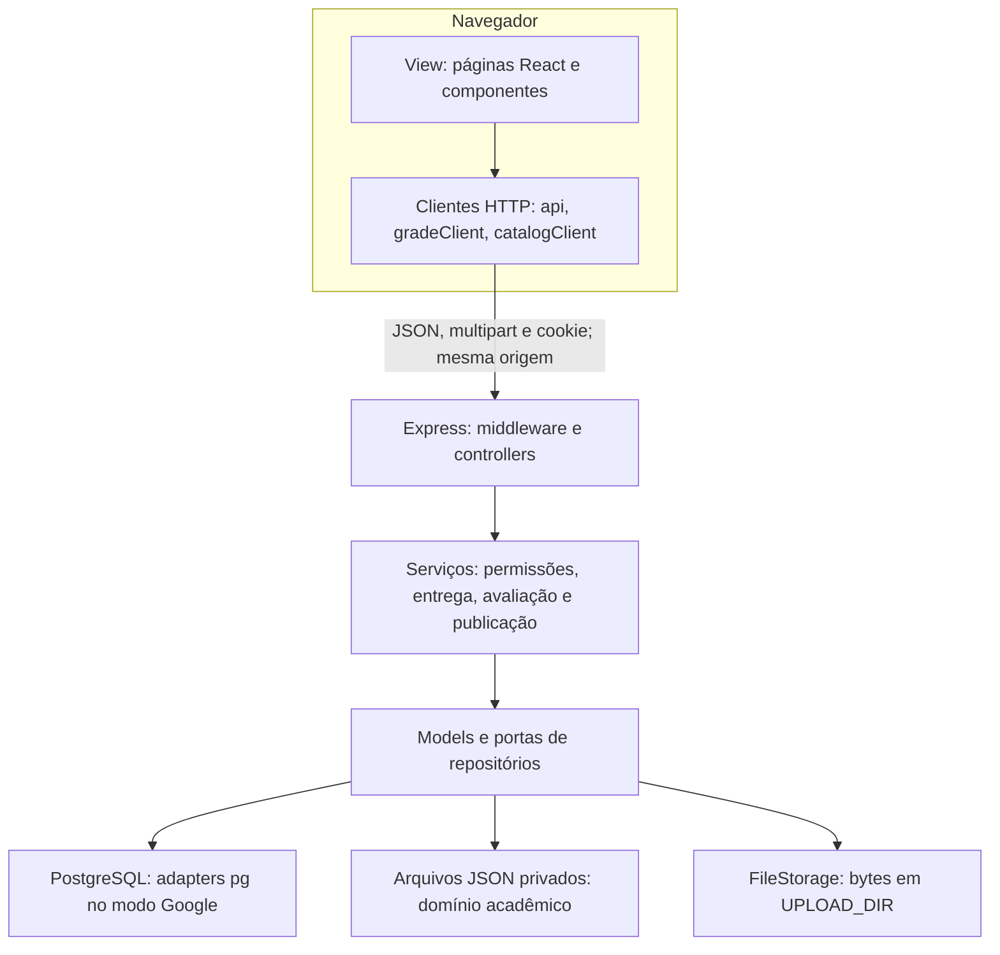
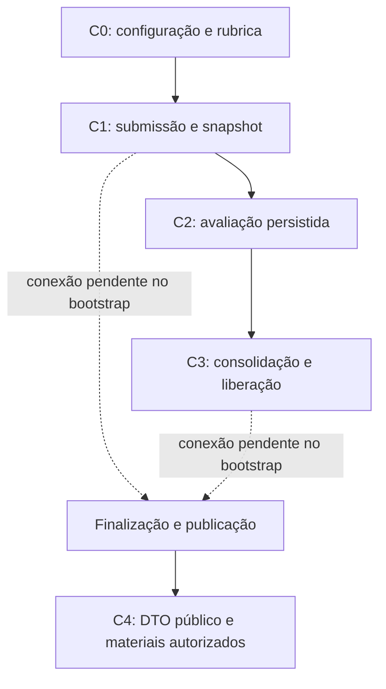

# Arquitetura e componentes atuais

Revisão documental de 25/11/2026, base `c2dbb7f`. Fontes: `packages/api/src/server.ts`, `app.ts`, `routes/`, `services/`, `repositories/` e `packages/web/src/`. O [registro da semana 5](arquitetura-semana-5.md) permanece como histórico.

## MVC e implantação

A View não consulta o banco nem determina a autorização. Middleware valida sessão/origem e os controllers aplicam escopo por turma, grupo e avaliador. Serviços validam regras, snapshots e transições. Repositórios persistem antes de expor o novo estado. O bootstrap é `server.ts`; `createApp` permite dependências injetáveis nos testes.

No desenvolvimento, Vite encaminha `/api` para `API_PORT`. O build gera frontend estático em `packages/web/dist` e API em `packages/api/dist`; não há servidor unificado de produção no repositório. Uma implantação deve servir o frontend com fallback de SPA e encaminhar `/api` à API na mesma origem. `NODE_ENV=production` exige `APP_ORIGIN` HTTPS. Não há Docker Compose versionado.

## Persistência efetiva

| Dados | Modo local/demonstração | Modo Google |
| --- | --- | --- |
| Usuários, turmas e papéis iniciais | Diretório configurado; seed em `fixtures/demo.ts` ou `AUTH_USERS_FILE` | PostgreSQL: identidade, administração e diretório |
| Sessões e tentativas OAuth | Sessões locais em memória | PostgreSQL: `auth_session` e `oauth_login_attempt` |
| Grupos, integrantes e atribuições | `GROUP_DATA_FILE` | PostgreSQL e auditoria de vínculos |
| Projetos, materiais, mensagens, submissões e decisões de publicação | `PROJECT_DATA_FILE` | Mesmo adapter JSON privado |
| Versões de requisitos e rubricas | `RUBRIC_DATA_FILE` | Mesmo adapter JSON privado |
| Avaliações e histórico C2 | `EVALUATION_DATA_FILE` | Mesmo adapter JSON privado |
| Decisões de liberação C3 | `RESULT_RELEASE_DATA_FILE` | Mesmo adapter JSON privado |
| Vídeos, PDFs e demais arquivos | `UPLOAD_DIR`, privado | Mesmo adapter de disco |

Os nomes `createMemory*Repository` não significam ausência de persistência quando o bootstrap fornece storage em arquivo. O modelo Prisma/SQL contém tabelas de domínio alvo sem adapter SQL ativo para todos os agregados. O PostgreSQL é acessado por `pg`; Prisma mantém as migrations. Ver [DER](diagrama-er.md).

Somente um processo escritor deve usar o conjunto de JSON e uploads. Sessões Google persistentes não tornam os arquivos seguros para múltiplas réplicas concorrentes. Backup deve copiar conjuntamente todos esses dados e, no Google, o banco.

## Contratos e conexões

- **Integrado:** política C0 no upload/checklist; C1 na avaliação; `evaluationService` fornece C2 real à consolidação; liberação é vinculada à versão efetiva do resultado.
- **Pendente:** `server.ts` não injeta `publicationProviders`. O adapter C1 `createSubmissionProvider` já existe; ainda é preciso compor C1/C3 reais e injetá-los. O serviço recusa finalização/publicação com `PUBLICATION_INTEGRATION_UNAVAILABLE` em vez de publicar por suposição.
- O catálogo `/api/catalog` lê decisões públicas persistidas. Sem a conexão acima, o servidor normal não consegue produzir novas decisões válidas de finalização/publicação.
- Rotas alternativas `/api/public/projects` usam `readProviders`, não fornecido no bootstrap. O cliente público atual usa `/api/catalog`; não confundir os dois contratos.
- Fixtures de publicação, Google e notas ficam em `packages/api/integration/` e são iniciadas pelos E2E. Não são adapters de produção.

## Interface e organização

`App.tsx` escolhe página inicial, acervo ou área autenticada. `pages/` contém login, dashboard, detalhe, andamento, turmas e perfil; `layout/AppShell.tsx` reúne a navegação. Componentes coss ui/Base UI e tokens Tailwind estão em `components/ui/` e `index.css`. A sessão vem da API; o frontend não mantém credenciais em localStorage.

O quadro do produto usa Preparação, Ajustes, Em avaliação e Finalizado. Publicado é uma decisão de exposição, não um quinto valor de `ProjectStatus`. Ver [estados](estados-do-projeto.md).

## Segurança e limites

Cookie HttpOnly, SameSite=Lax e Secure em produção; mutações exigem `X-CSRF-Protection: 1` e origem compatível quando informada. Permissões são revalidadas no servidor; ocultar controles não é autorização. Upload usa multipart, inspeção de bytes, limites, checksum e armazenamento privado. O catálogo expõe DTO autorizado, sem notas ou mensagens; retirada bloqueia novas consultas e requisições de arquivo, inclusive Range.

Os diagramas de [classes](diagrama-classes.md), [sequência](diagramas-sequencia.md) e [dados](diagrama-er.md) mostram recortes da implementação e indicam explicitamente as conexões ainda pendentes.
