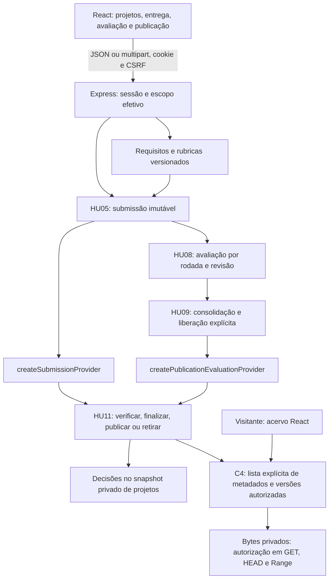

# Arquitetura integrada — semana 7

Arquitetura executável da aplicação. O DER descreve também funcionalidades planejadas; esta página identifica os componentes conectados, as fronteiras de autorização e a persistência efetiva.

## Composição e fronteiras

`server.ts` abre os repositórios persistentes e os injeta em `createApp`. A factory mantém portas substituíveis para testes; não carrega dados de avaliação de exemplo por padrão. Com `evaluationRepository`, cria o serviço real de avaliação. Consolidação e publicação compartilham a mesma instância de `EvaluationProvider` e o mesmo repositório de liberações.

O adapter C1 consulta a última rodada persistida, inclusive quando devolvida; a HU11 recusa esse estado. O adapter C3 chama `consolidate`, reutilizando validação da rubrica, critérios e notas. Projeta apenas IDs e sinais de completude/liberação; não transporta notas ou comentários para a publicação. O fingerprint identifica uma liberação do resultado ao grupo; não constitui autorização de divulgação.

`publicationService` autentica o escopo docente, verifica a mesma rodada/rubrica e os avaliadores atuais, confere metadados e presença/tamanho dos arquivos e relê C1/C3 após as operações assíncronas. Só então grava a decisão. Uma reabertura concorrente não pode aproveitar a prontidão anterior. Depois de `FINALIZADO`, as rotas reais de avaliação e devolução recusam alterações da rodada. Ações da HU11 são serializadas por projeto dentro do processo; não há transação distribuída entre processos.

Controllers validam schemas, sessão e CSRF; serviços aplicam regras; repositórios gravam antes de atualizar o estado em memória. A View recebe permissões do backend. ADMIN em prévia usa o perfil e os vínculos efetivos; o autor das decisões HU11 é a conta real da sessão.

## Persistência efetiva

| Informação | Armazenamento e configuração |
| --- | --- |
| Projetos, materiais, versões, mensagens, rodadas C1, reaberturas e decisões HU11 | Snapshot privado `PROJECT_DATA_FILE` |
| Requisitos e rubricas históricas | `RUBRIC_DATA_FILE`, padrão `${PROJECT_DATA_FILE}.rubrics.json` |
| Avaliações e histórico de revisões C2 | `EVALUATION_DATA_FILE`, padrão `${PROJECT_DATA_FILE}.evaluations.json` |
| Decisões de liberação C3 | `RESULT_RELEASE_DATA_FILE`, padrão `${PROJECT_DATA_FILE}.results.json` |
| Conteúdo dos materiais | Disco privado `UPLOAD_DIR`; nunca servido estaticamente |
| Contas locais | Diretório JSON provisionado ou contas optativas de demonstração |
| Vínculos e auditoria locais | `GROUP_DATA_FILE`, padrão `${PROJECT_DATA_FILE}.groups.json` |
| Identidades, vínculos, auditoria, sessões e tentativas OAuth no modo Google | PostgreSQL; migrations anteriores preservadas |
| Sessões locais | Memória; novo login após reiniciar |

Os arquivos privados exigem um único escritor e disco persistente. O snapshot de finalização e o estado `FINALIZADO` são gravados juntos no arquivo de projetos. Avaliações e liberações estão em arquivos separados; para backup consistente, pare o escritor e conserve todo o conjunto, incluindo vínculos e bytes. Procedimento: [instalação e restauração](instalacao-e-aceitacao.md#backup-e-restauração-de-teste).

## Exposição pública

A listagem e o detalhe retornam somente uma decisão `PUBLICADO` ativa de um projeto `FINALIZADO`. O DTO C4 é construído campo a campo; a referência de consentimento permanece no histórico privado. O catálogo não recebe notas, mensagens, integrantes, rubrica, checksums ou chaves de armazenamento.

Cada abertura de bytes verifica a seleção autorizada e a publicação ativa, novamente após acessar o disco. A retirada revoga listagem, detalhe, GET, HEAD e novas requisições Range sem apagar os dados privados. Respostas usam `no-store`; bytes já recebidos e streams já iniciados não podem ser recolhidos. Veja [C4](contratos/c4-publicacao.md) e [limitações](limitacoes.md).

## Verificação e revisão

[publicationIntegration.test.ts](../packages/api/src/routes/publicationIntegration.test.ts) exercita C1/C2/C3/C4, reinício dos repositórios, isolamento, nova rodada e concorrência com arquivos reais. [publication-flow.spec.ts](../e2e/publication-flow.spec.ts) usa o entrypoint normal em desktop e celular emulado, sem provedores de submissão/avaliação simulados. Testes isolados com doubles continuam úteis, mas suas evidências ficam identificadas separadamente. Os comandos de verificação estão na [validação da entrega](../README.md#validação-da-entrega); a aprovação dos fluxos depende da revisão da equipe.
