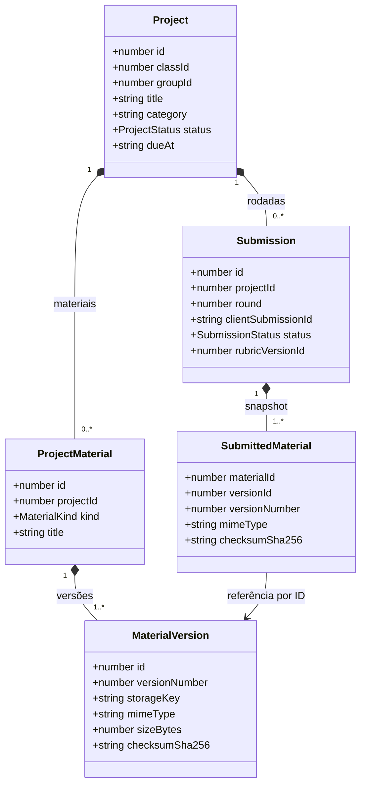
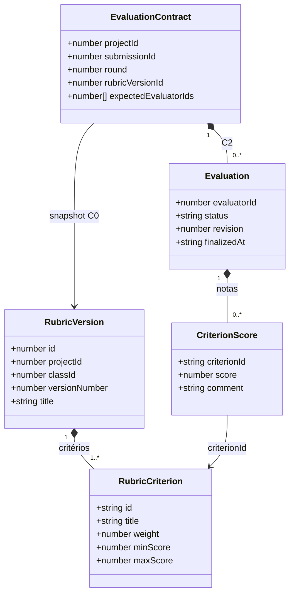
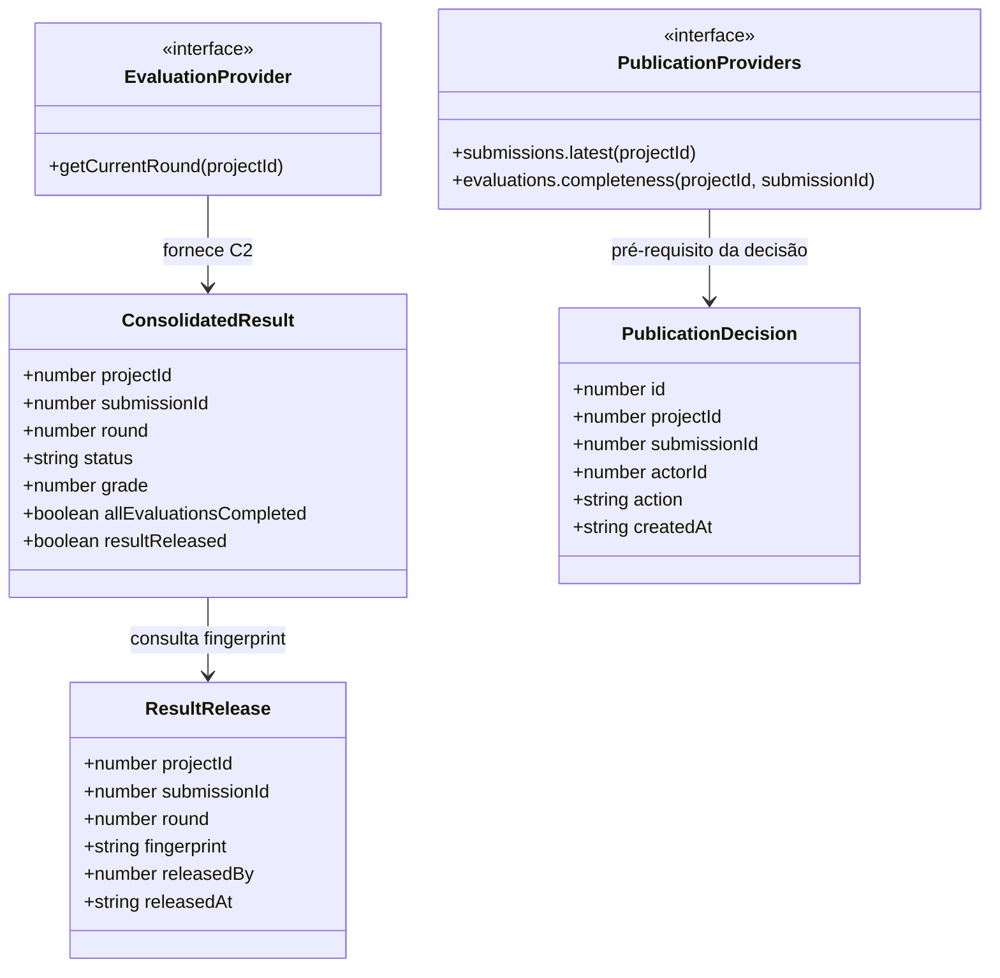

# Classes e tipos do domínio implementado

Integração revisada em 25/11/2026. O backend usa interfaces TypeScript, schemas Zod e factories; os blocos UML abaixo representam tipos e relações, não classes ORM instanciadas. IDs do domínio em execução são `number`; os tipos SQL do modelo relacional são tratados no [DER](diagrama-er.md).

## Projetos, materiais e rodadas

`Submission` também contém a cópia da rubrica usada na entrega. Não há alteração retroativa de uma rodada ao substituir um arquivo ou criar outra rubrica. Mensagens (`ProjectMessage`) têm projeto, autor e contexto opcional de versão; ficam no snapshot privado de projetos.

## Rubrica e avaliação

Rubricas são versionadas **por projeto**, com contexto de turma. Os três requisitos obrigatórios são vídeo, relatório e manual. Pesos somam 100%; notas variam de 0 a 10. Avaliações usam `PENDENTE`, `RASCUNHO`, `FINALIZADA` ou `REABERTA`, com revisão e histórico. A reabertura exige justificativa; não há campo `isFinal` no tipo C2 atual.

## Consolidação e decisões

`ResultRelease` identifica o resultado efetivo por fingerprint; alterações na rodada/avaliação podem tornar a liberação anterior inaplicável. `PublicationDecision` é uma união: `FINALIZADO` guarda a submissão, `PUBLICADO` guarda autorização e DTO público, `RETIRADO` registra a retirada. O bootstrap fornece os repositórios persistentes; `createApp` compõe os `PublicationProviders` reais com `createSubmissionProvider` e `createPublicationEvaluationProvider`. Ver [arquitetura](arquitetura.md).
