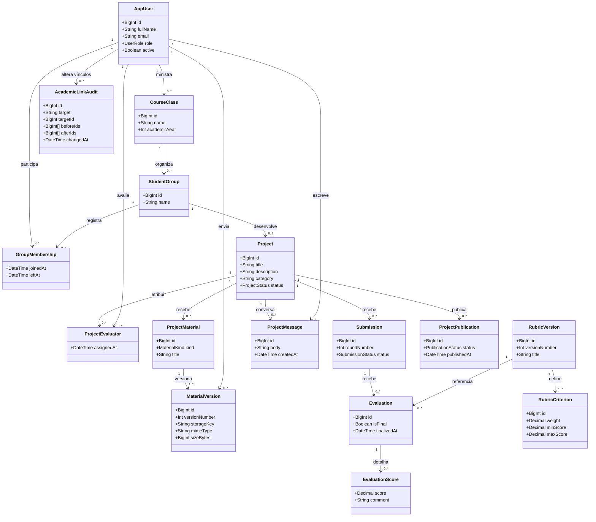

# Diagrama de classes inicial

Modelo de domínio que acompanha o [DER](diagrama-er.md). As classes representam os objetos e serviços principais; a autorização e as regras entre objetos ficam na camada de serviço.

O diagrama mostra o domínio completo planejado. Na S5, identidades/sessões e grupos/vínculos Google usam PostgreSQL; projetos/metadados/mensagens usam arquivo privado e bytes ficam em disco privado. No modo local, grupos/vínculos usam arquivo separado. As factories de teste continuam injetáveis e em memória. A relação de projeto com avaliador é lógica: o projeto efetivo ainda é resolvido no snapshot, sem FK para a tabela legada. Veja [revisão da arquitetura](arquitetura-semana-5.md) e [decisão da HU02](hu02.md).
