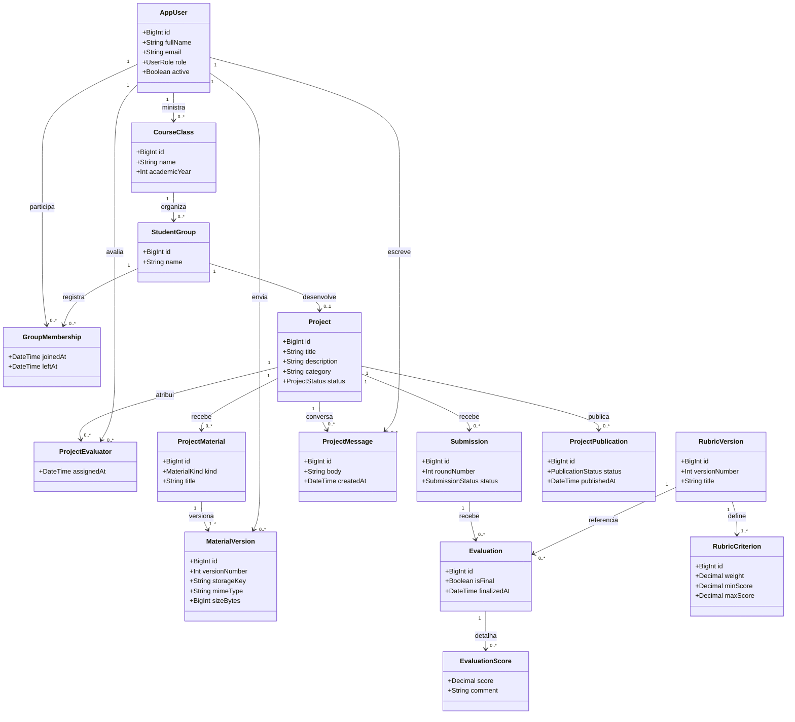

# Diagrama de classes inicial

Modelo de domínio que acompanha o [DER](diagrama-er.md). As classes representam os objetos e serviços principais; a autorização e as regras entre objetos ficam na camada de serviço.

O escopo da TEC02 inicia a View React, os controllers REST e o schema Prisma. A implementação inicial das rotas usa dados em memória; a integração persistente com PostgreSQL permanece para a etapa de persistência.
