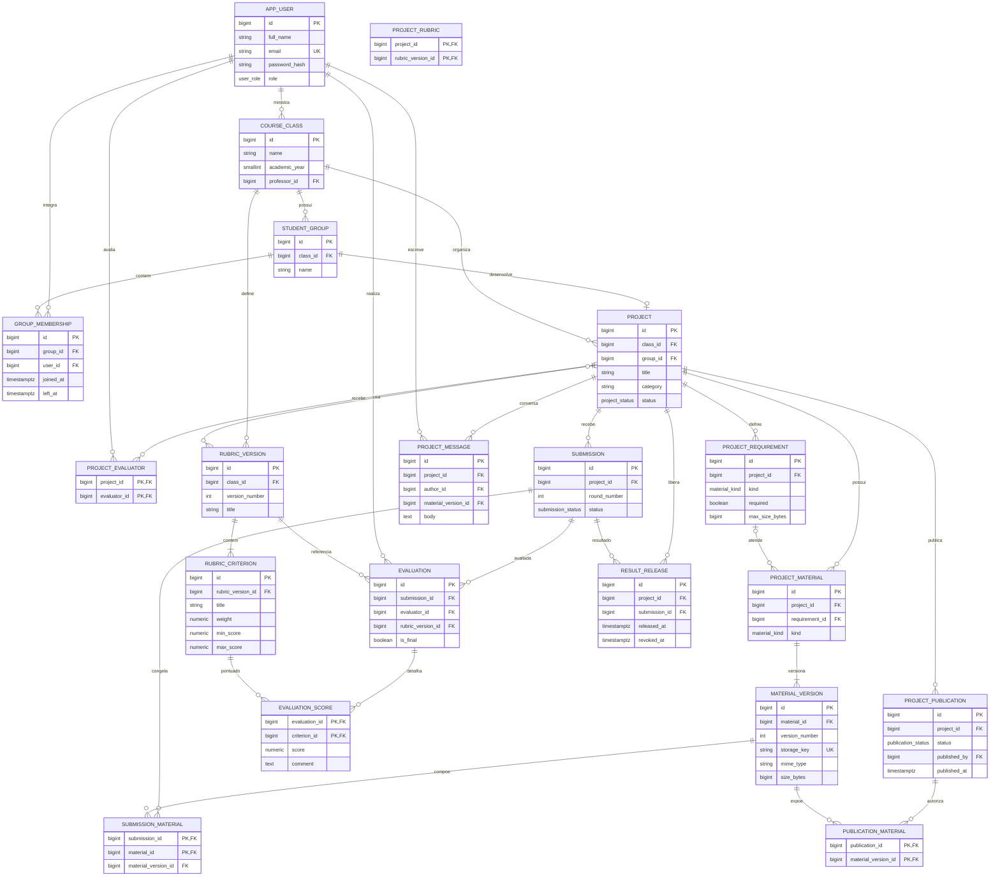

# Diagrama entidade-relacionamento

Modelo lógico inicial do MVP do Labrary Digital. Os arquivos binários permanecem em armazenamento privado; o banco guarda metadados e chaves de armazenamento. A criação física está em [`db/schema.sql`](../db/schema.sql).

## Regras importantes

- Um projeto pertence a um único grupo e turma. A chave estrangeira composta impede que o grupo de outra turma seja associado ao projeto.
- O histórico de integrantes preserva entradas e saídas; um aluno só pode ter um vínculo ativo com grupo por vez.
- Cada envio cria uma rodada (`submission`) e fixa as versões exatas em `submission_material`, sem sobrescrever materiais anteriores.
- A rubrica e seus critérios são versionados; cada avaliação registra qual versão usou.
- Mensagens, notas, versões de materiais e resultados são privados. A publicação é explícita e associa somente versões autorizadas.
- A soma dos pesos da rubrica, a autorização por papel e as regras de transição de estado devem ser validadas pela camada de serviço/transação da aplicação.
