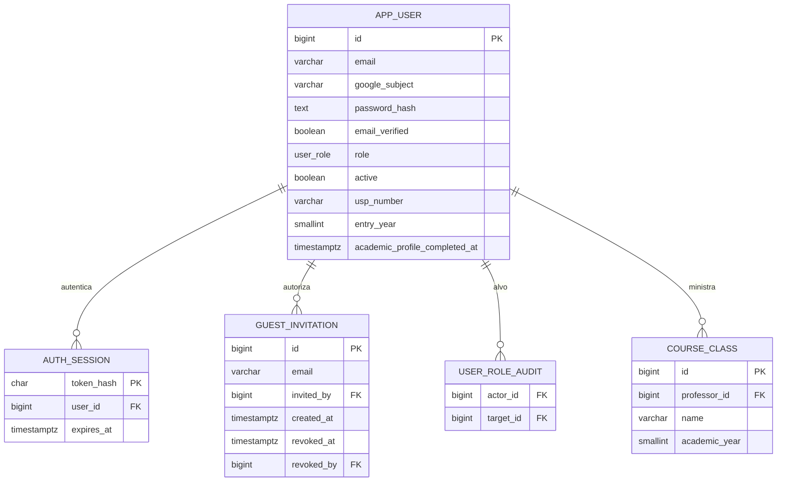
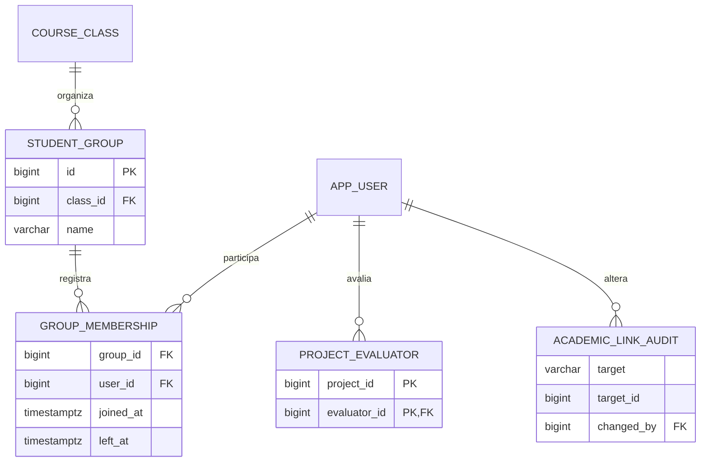
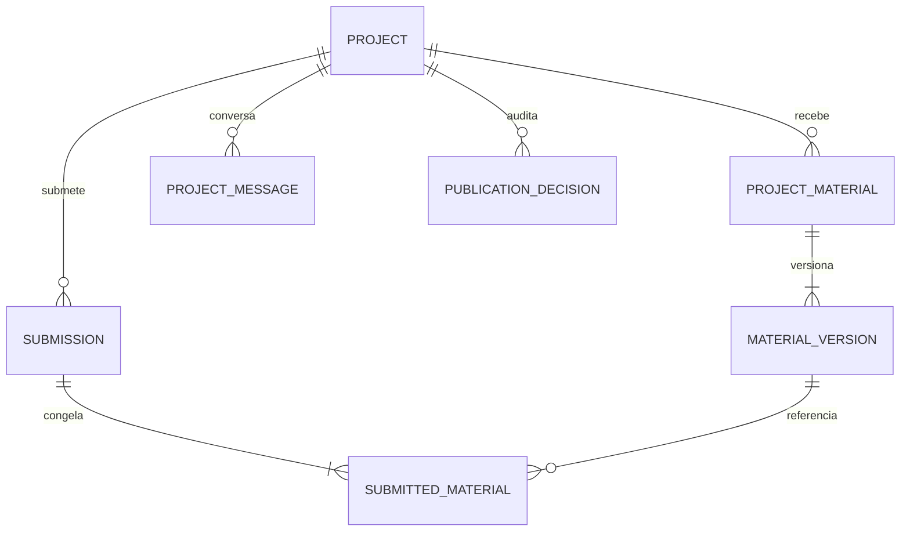
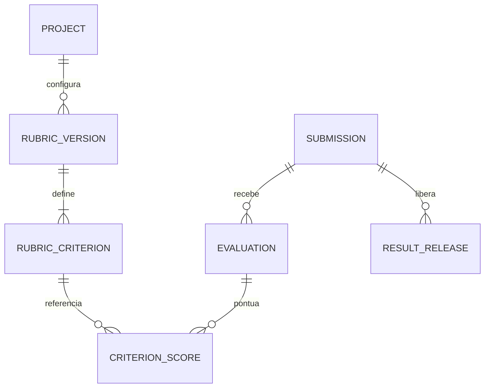

# Dados: relações físicas e lógicas

Este documento apresenta as tabelas PostgreSQL ativas e as relações lógicas dos agregados acadêmicos armazenados em JSONB no próprio banco. O [schema Prisma](../packages/api/prisma/schema.prisma) e o [SQL inicial](../db/schema.sql) descrevem um modelo relacional mais amplo; a presença de uma tabela não comprova seu uso pelo servidor.

## PostgreSQL ativo no modo Google

Recortes das relações utilizadas pelos adapters em `repositories/postgres*`. Campos abaixo são uma seleção; consulte as [migrations](../packages/api/prisma/migrations) para a definição física completa.

A auditoria de papéis também referencia `APP_USER` por `actor_id`. `auth_session.view_role` representa a visualização acadêmica escolhida pelo ADMIN; não altera o papel real. `oauth_login_attempt` persiste state/nonce/PKCE e expiração antes de existir uma sessão; não é uma entidade de conteúdo acadêmico. Hashes de sessão e de state substituem os tokens em claro.

`project_evaluator.project_id` é uma referência lógica ao projeto do agregado `academic_state` no PostgreSQL. A migration `20261107000000_academic_links` removeu sua FK para a tabela `project` histórica; a aplicação valida projeto e turma. A FK para o avaliador permanece. Participações encerradas e auditoria preservam o histórico. O login usa Google com validação do e-mail USP ou convite vigente. NUSP, ano de ingresso e conclusão do cadastro ficam em `app_user`; convites conservam o histórico em `guest_invitation`. Não há integração com Senha Única USP. As oito contas fictícias do desenvolvimento usam estas mesmas tabelas, com hash scrypt e `google_subject` nulo, sem simular uma identidade Google verificada. O cadastro da conta reservada e o convite do convidado fictício não exigem novas tabelas/migrations.

## Domínio acadêmico no PostgreSQL

As relações abaixo são **lógicas, não tabelas/FKs SQL ativas**:

Uma submissão guarda também a cópia dos critérios de avaliação. Projetos, critérios de avaliação, avaliações e liberações ocupam registros separados na tabela `academic_state`, com payload JSONB e referências verificadas pelos serviços. A decisão de publicação guarda snapshot e autorização; seus pré-requisitos reais C1/C3 são compostos em `createApp`, a partir dos repositórios persistentes fornecidos pelo bootstrap.

| Agregado | Armazenamento no modo Google |
| --- | --- |
| Projetos, metadados, mensagens, rodadas e publicação | `academic_state`, domínio `projects` |
| Requisitos e critérios de avaliação | `academic_state`, domínio `rubrics` |
| Avaliações | `academic_state`, domínio `evaluations` |
| Liberações | `academic_state`, domínio `results` |
| Auditoria da importação legada | `academic_data_import` |
| Controle de operações R2 | `r2_usage` |
| Bytes de cada versão | R2 privado, referenciado por `storageKey` |

`academic_state` tem `domain` como chave primária, `payload` JSONB e `updated_at`. Cada operação carrega o estado do banco; alterações bloqueiam a linha e aguardam COMMIT. `r2_usage` tem escopo conta/bucket, mês UTC e contadores A/B, reservados por UPDATE atômico. `academic_data_import` registra o hash SHA-256 da origem importada para impedir reimportações destrutivas.

Os agregados JSONB não foram normalizados nas tabelas acadêmicas históricas: os vínculos internos continuam validados pela aplicação. Não há transação distribuída com o R2. Um dump SQL inclui todos os dados acadêmicos; os bytes exigem backup separado do bucket. Ver [backup e aceitação](instalacao-e-aceitacao.md).
