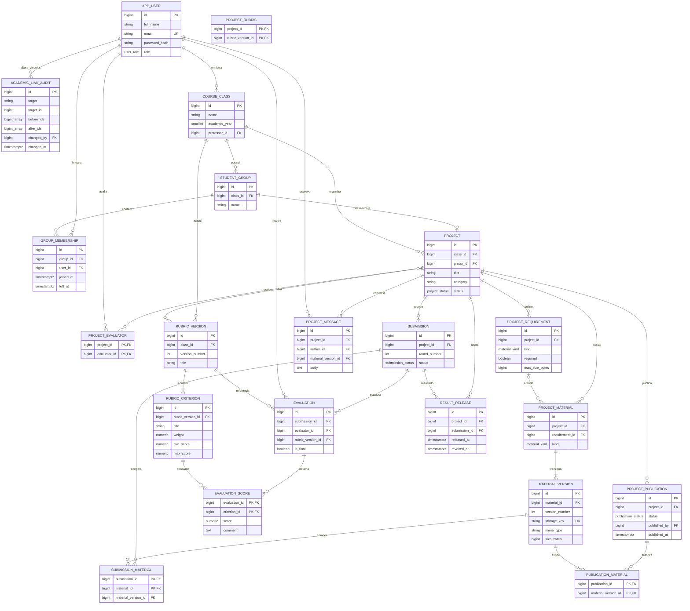

# Diagrama entidade-relacionamento

Modelo lógico inicial do MVP do Labrary Digital. Os arquivos binários permanecem em armazenamento privado; o banco guarda metadados e chaves de armazenamento. O snapshot original está em [`db/schema.sql`](../db/schema.sql); a evolução física usa [migrations](login-google.md). `app_user` também contém `usp_number` único, `usp_affiliations` JSONB e `usp_synced_at`, e permite `password_hash` nulo para contas institucionais.

## Regras importantes

- Um projeto pertence a um único grupo e turma. A chave estrangeira composta impede que o grupo de outra turma seja associado ao projeto.
- O histórico de integrantes preserva entradas e saídas. Desde a migration da HU02/S5, há unicidade do par grupo/usuário ativo, permitindo vários grupos explicitamente vinculados; o snapshot SQL inicial conserva a regra antiga.
- Cada envio cria uma rodada (`submission`) e fixa as versões exatas em `submission_material`, sem sobrescrever materiais anteriores.
- A rubrica e seus critérios são versionados; cada avaliação registra qual versão usou.
- Mensagens, notas, versões de materiais e resultados são privados. A publicação é explícita e associa somente versões autorizadas.
- A soma dos pesos da rubrica, a autorização por papel e as regras de transição de estado devem ser validadas pela camada de serviço/transação da aplicação.

A migration Google acrescenta `google_subject` único (identificador `sub`), `email_verified` e `google_synced_at` em `app_user`, além de unicidade do e-mail sem distinguir maiúsculas. `auth_session` referencia `app_user` e guarda somente hash do token e expiração. `oauth_login_attempt` guarda hash de state, nonce, verificador PKCE e expiração, com consumo atômico. Os campos USP permanecem preservados como histórico; não há integração USP ativa.

A migration administrativa adiciona ADMIN ao enum `user_role`, `auth_session.view_role` opcional restrito a papéis acadêmicos, e `user_role_audit` com FKs `actor_id`/`target_id` para `app_user`. A prévia fica vinculada à sessão, e a conta mantém seu papel real. Essa etapa chegou a 23 tabelas de domínio; a HU02/S5 acrescenta a auditoria de vínculos, totalizando 24, além de `_prisma_migrations`.

Na S5, `academic_link_audit` registra alvo (`GROUP`/`PROJECT`), ID, conjuntos anterior/posterior de contas, autor e data. `project_evaluator.project_id` aponta logicamente para o projeto do snapshot privado, sem FK para a tabela legada `project`; a aplicação valida existência e turma antes de gravar. A FK do avaliador permanece. Veja [HU02](hu02.md) e [arquitetura efetiva](arquitetura-semana-5.md). As demais relações do DER representam o modelo alvo, não adapters já integrados.
