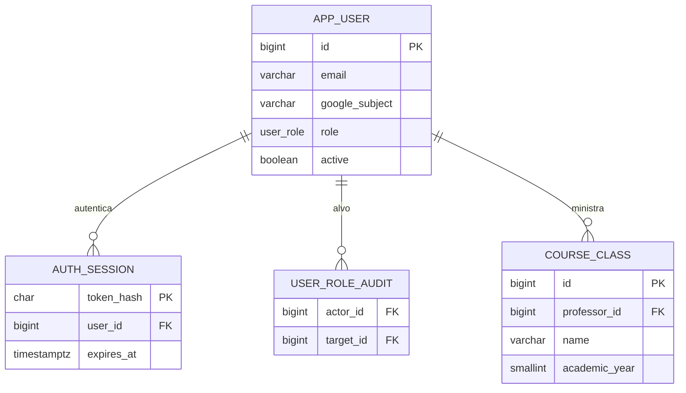
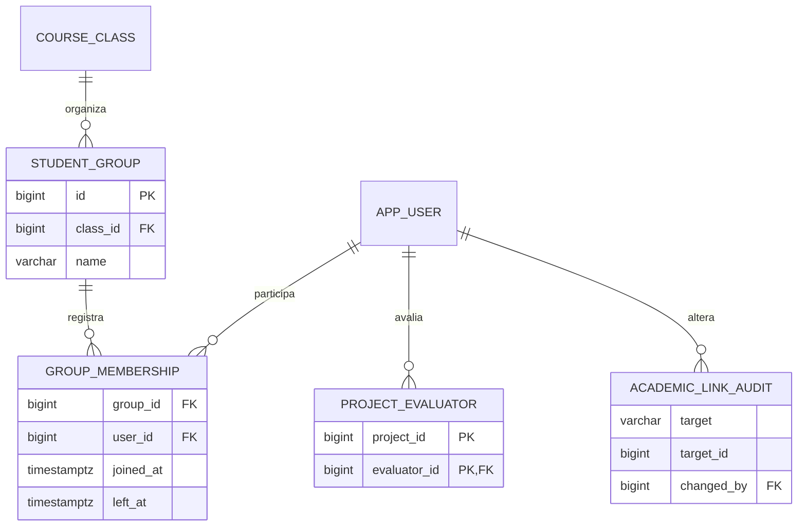
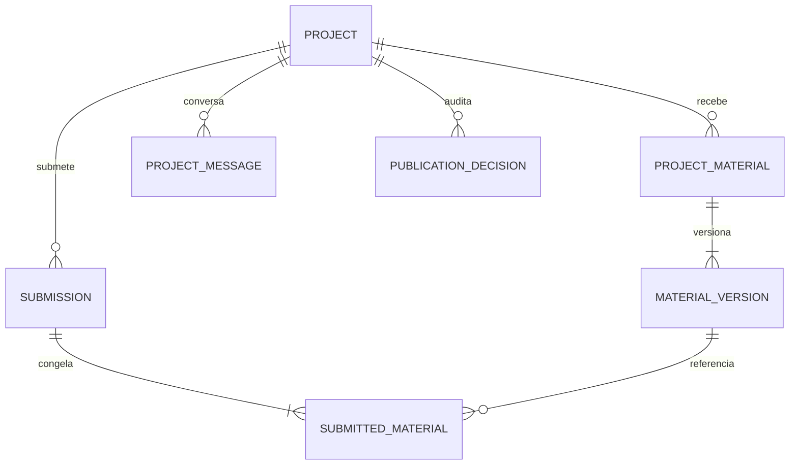
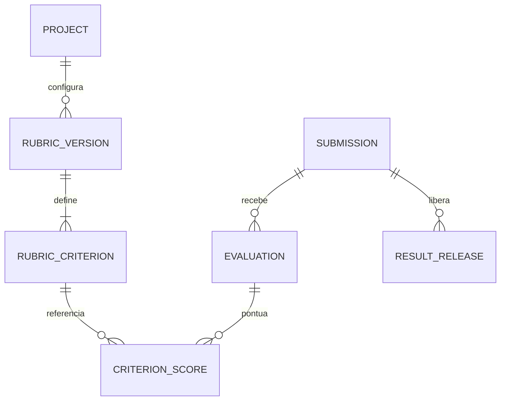

# Dados: relações físicas e lógicas

Base `c2dbb7f`, revisão de 25/11/2026. Este documento separa as tabelas efetivamente usadas pelos adapters PostgreSQL das relações lógicas persistidas em JSON. O [schema Prisma](../packages/api/prisma/schema.prisma) e o [SQL inicial](../db/schema.sql) descrevem um modelo relacional mais amplo; a presença de uma tabela não comprova seu uso pelo servidor.

## PostgreSQL ativo no modo Google

Recortes das relações utilizadas pelos adapters em `repositories/postgres*`. Campos abaixo são uma seleção; consulte as [migrations](../packages/api/prisma/migrations) para a definição física completa.

A auditoria de papéis também referencia `APP_USER` por `actor_id`. `auth_session.view_role` representa a visualização acadêmica escolhida pelo ADMIN; não altera o papel real. `oauth_login_attempt` persiste state/nonce/PKCE e expiração antes de existir uma sessão; não é uma entidade de conteúdo acadêmico. Hashes de sessão e de state substituem os tokens em claro.

`project_evaluator.project_id` é uma referência lógica ao projeto do JSON privado. A migration `20261107000000_academic_links` removeu sua FK para a tabela `project` histórica; a aplicação valida projeto e turma. A FK para o avaliador permanece. Participações encerradas e auditoria preservam o histórico. As colunas USP foram mantidas por compatibilidade; não há SSO USP ativo.

## Domínio acadêmico persistido em JSON

As relações abaixo são **lógicas, não tabelas/FKs SQL ativas**:

Uma submissão guarda também a cópia da rubrica. Rubricas/avaliações/liberações usam arquivos separados, com referências verificadas pelos serviços. A decisão de publicação guarda snapshot e autorização; a conexão dos seus pré-requisitos reais ao bootstrap ainda está pendente.

| Agregado | Armazenamento configurável |
| --- | --- |
| Projetos, metadados, mensagens, rodadas e decisões de publicação | `PROJECT_DATA_FILE` |
| Grupos e vínculos locais | `GROUP_DATA_FILE` |
| Requisitos e rubricas | `RUBRIC_DATA_FILE` |
| Avaliações | `EVALUATION_DATA_FILE` |
| Liberações | `RESULT_RELEASE_DATA_FILE` |
| Bytes de cada versão | Disco privado `UPLOAD_DIR`, referenciado por `storageKey` |

IDs e fingerprints conectam os agregados; não existe transação distribuída entre PostgreSQL e os vários JSON. Um backup apenas SQL não restaura os materiais, as avaliações nem as rodadas. Ver [backup e aceitação](instalacao-e-aceitacao.md).
