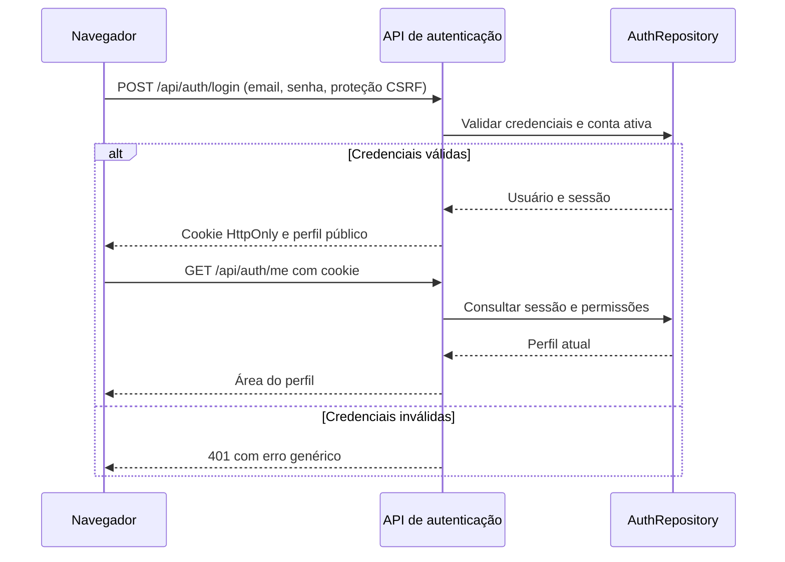
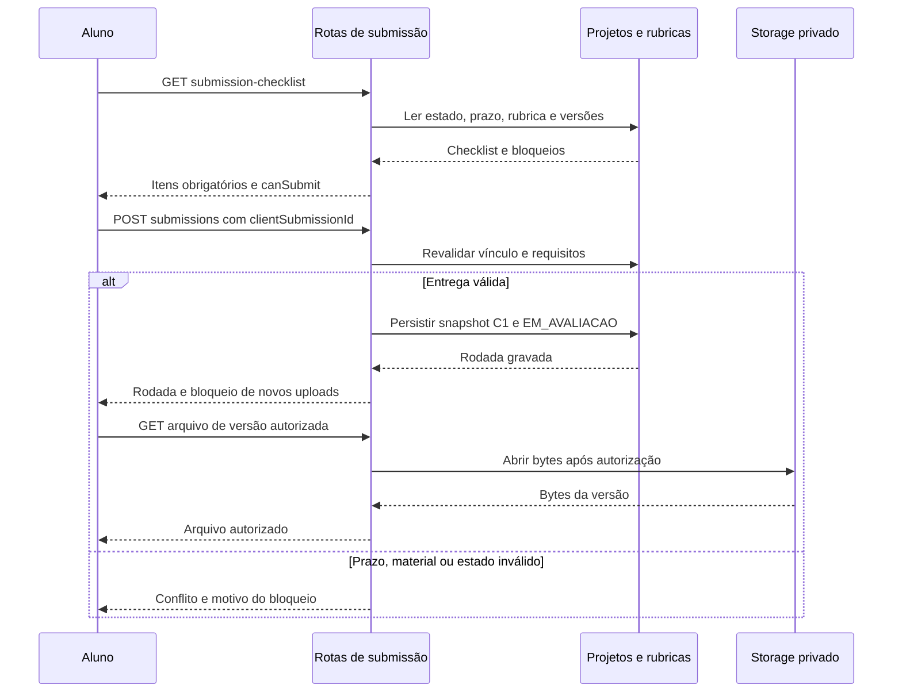
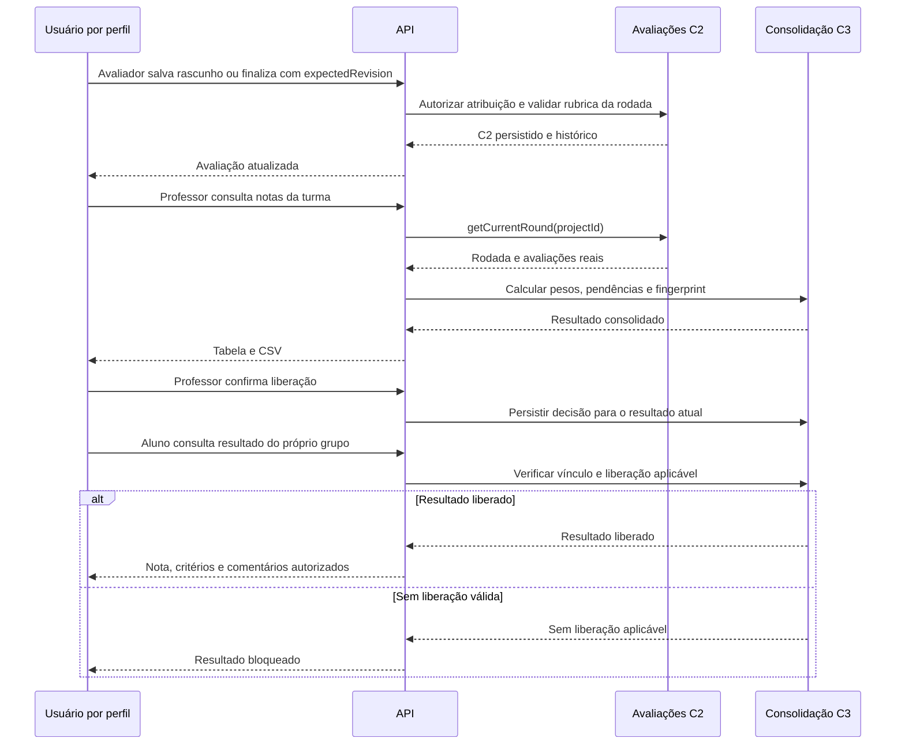
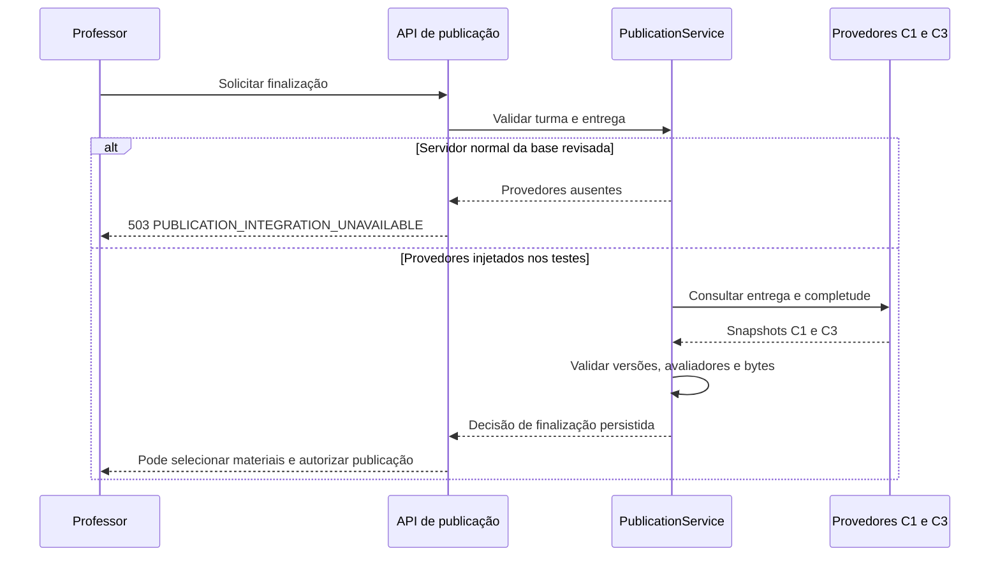

# Diagramas de sequência

Base `c2dbb7f`, revisão de 25/11/2026. Diagramas de comportamento; validações de entrada e erros menores foram agrupados. As permissões são sempre decididas pela API.

## Login e sessão local

No Google, `/api/auth/google` cria uma tentativa OAuth e redireciona ao provedor. O callback verifica state, nonce, PKCE e ID token; persiste identidade e sessão no PostgreSQL. Novos usuários são ALUNO sem vínculos automáticos. Ver [SSO](login-google.md).

## Submissão e preservação de versões

A submissão reutiliza bytes já enviados; não faz novo upload. Repetir o mesmo identificador de submissão não cria outra rodada. A devolução pelo professor muda o projeto para Ajustes e permite nova rodada sem apagar a anterior.

## Avaliação, consolidação e resultado

## Publicação: conexão real pendente

Este último diagrama não declara a integração concluída. O serviço de catálogo, arquivos autorizados e retirada existe; testes usam provedores injetados. Conectar os produtores reais e validar o fluxo no servidor normal é pendência de #42/#11.
