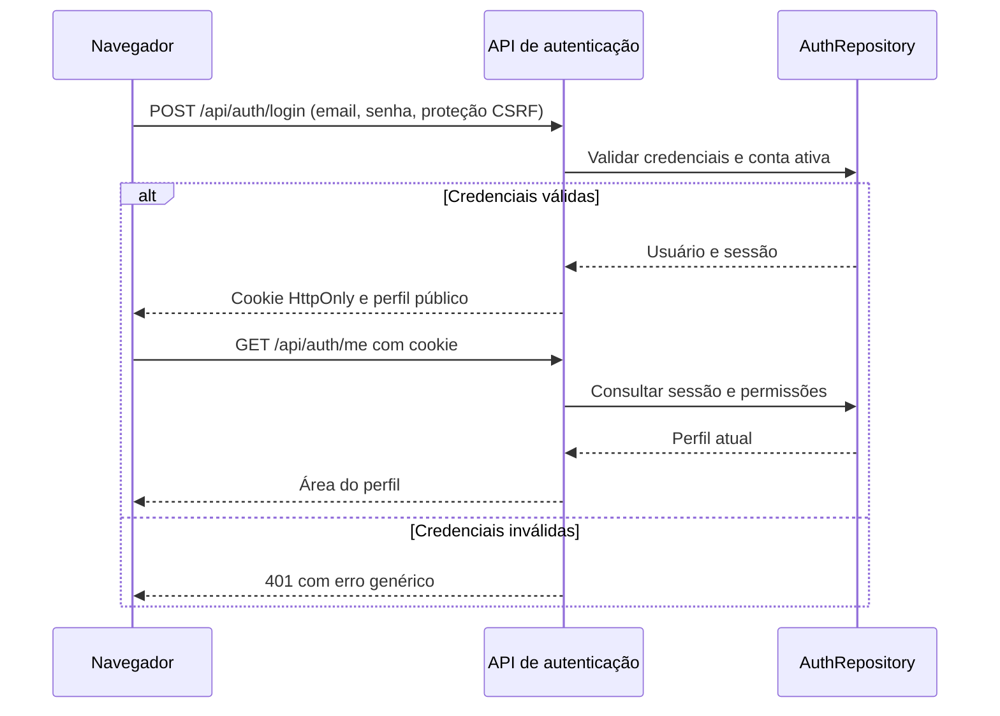
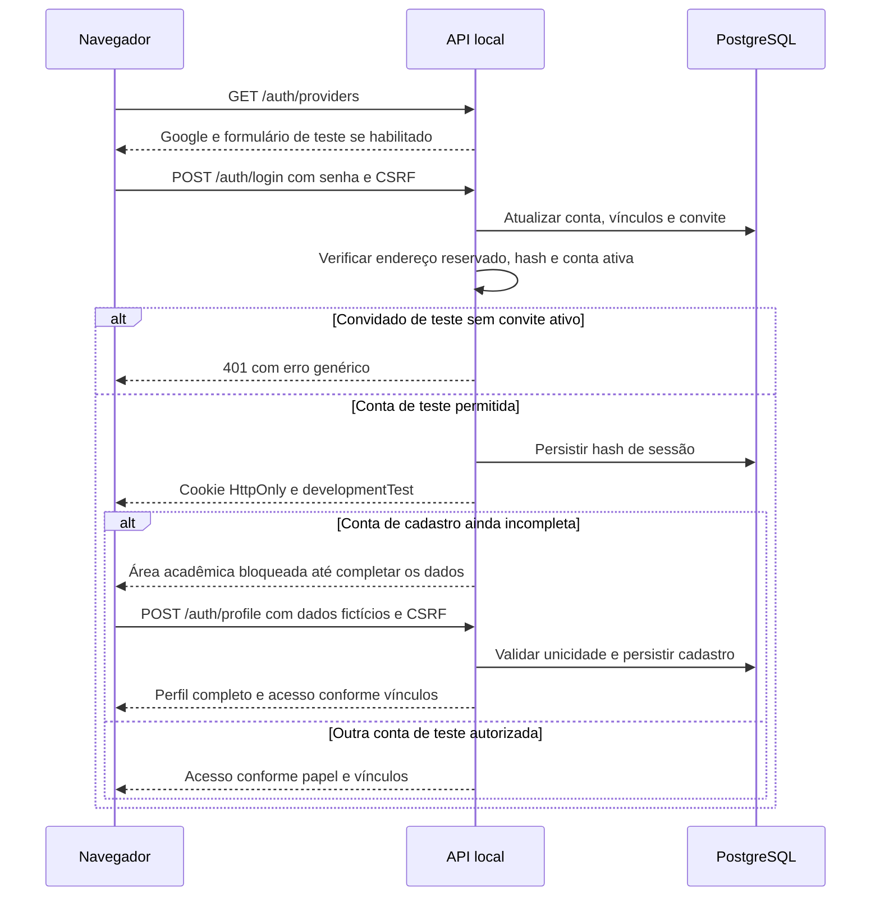
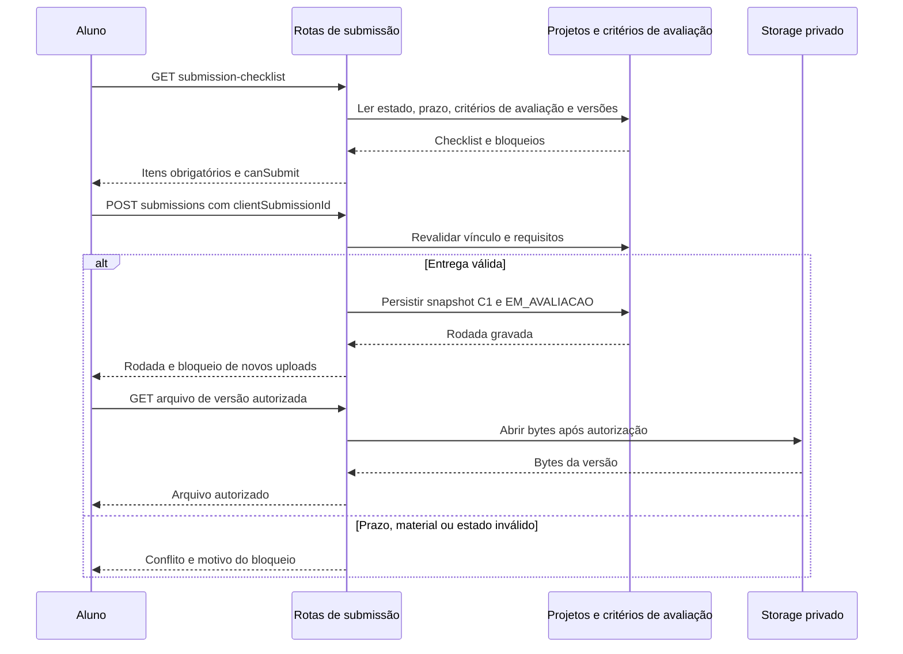
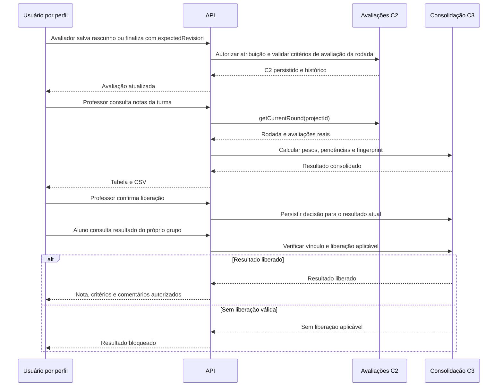
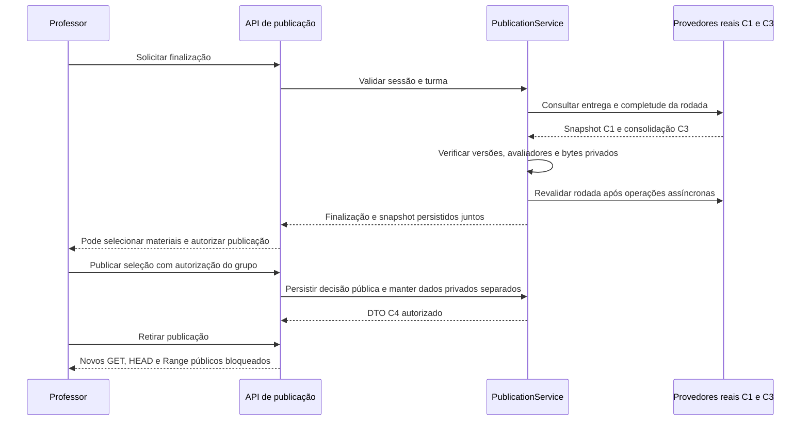

# Diagramas de sequência

Validações de entrada e erros menores foram agrupados. As permissões são sempre decididas pela API.

## Login e sessão local

No Google, `/api/auth/google` cria uma tentativa OAuth e redireciona ao provedor. O callback verifica state, nonce, PKCE e ID token, exige e-mail verificado `@usp.br` ou convite externo vigente e persiste identidade e sessão no PostgreSQL. Novos usuários são ALUNO sem vínculos automáticos. O aluno USP precisa concluir nome completo, NUSP e ano de ingresso antes das rotas privadas; convidados são dispensados desse cadastro. Revogar o convite encerra seu acesso. Ver [SSO](login-google.md).

## Contas fictícias no desenvolvimento Google/PostgreSQL

A opção é validada na inicialização: Google configurado, `NODE_ENV=development`, `DEV_TEST_LOGIN=true` e origem local. O callback Google permanece independente e autentica contas reais. Revogação do convite ou desativação bloqueia o convidado; desligar a opção bloqueia todas as sessões dos endereços reservados. As contas e o histórico permanecem no banco.

## Submissão e preservação de versões

A submissão reutiliza bytes já enviados; não faz novo upload. Repetir o mesmo identificador de submissão não cria outra rodada. A devolução pelo professor muda o projeto para Ajustes e permite nova rodada sem apagar a anterior.

## Avaliação, consolidação e resultado

## Publicação

`server.ts` injeta os repositórios; `createApp` compõe C1/C3 reais. Liberação de notas ao grupo é independente da autorização pública. O E2E `publication-flow.spec.ts` usa o servidor normal; as fixtures dos testes isolados continuam identificadas separadamente.
