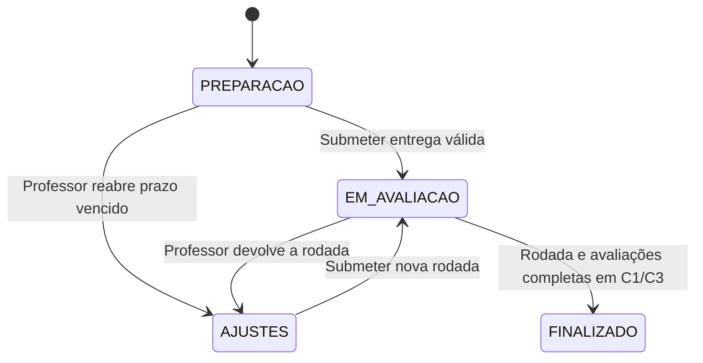
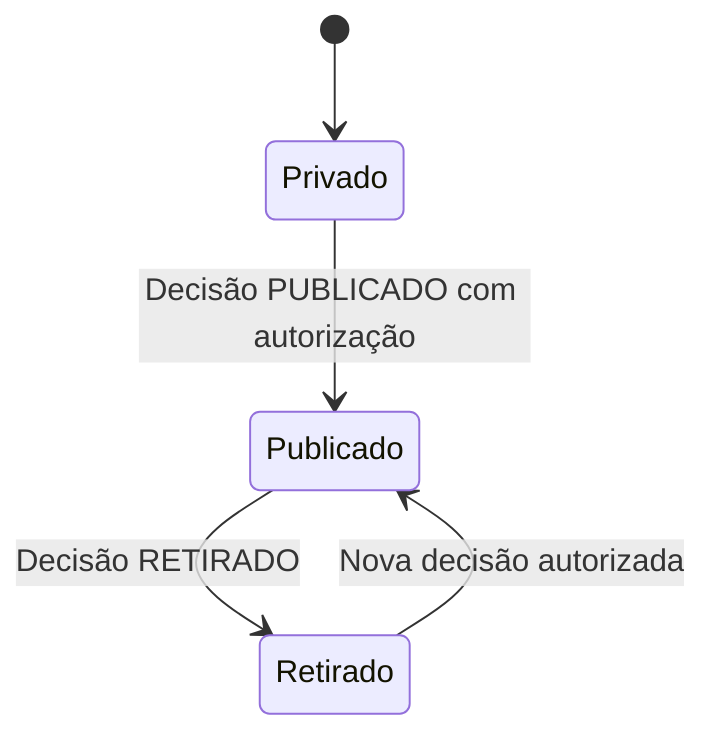

# Estados do projeto e decisões de publicação

Estado do código em 26/11/2026, incluindo a integração da main e os cenários de desenvolvimento. `ProjectStatus` possui quatro valores; publicação é uma sequência separada de decisões.

Preparação permite upload antes do prazo; Ajustes dispensa o prazo original. Em avaliação bloqueia alterações de materiais e conserva o snapshot da rodada. A reabertura de uma avaliação C2 não é a devolução da entrega C1: ela mantém a rodada e reabre notas, com justificativa/histórico, tornando a liberação anterior inaplicável quando o resultado efetivo muda.

O segundo diagrama só se aplica a um projeto com decisão válida `FINALIZADO`. Publicação não modifica o enum para `PUBLICADO`; expõe apenas versões selecionadas e um DTO público. Retirada conserva os dados privados e a auditoria, mas impede novos acessos públicos aos materiais. No servidor normal, `createApp` conecta C1/C3 aos repositórios reais; uma rodada incompleta ou devolvida impede a finalização. A avaliação completa permite finalizar, mas publicar continua exigindo decisão docente e autorização explícita.

O [roteiro completo](manual-de-uso.md#demonstração-completa-com-postgresql-e-r2) prepara exemplos em avaliação, ajustes, resultado liberado, finalizado privado, publicado, retirado e com prazo vencido. **Resultado liberado** não é um novo `ProjectStatus`: é uma decisão C3 independente. A preparação não restaura estados de cenários já existentes.
