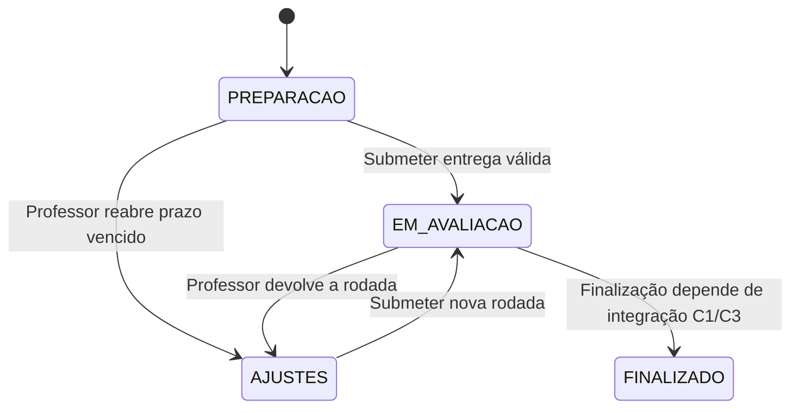
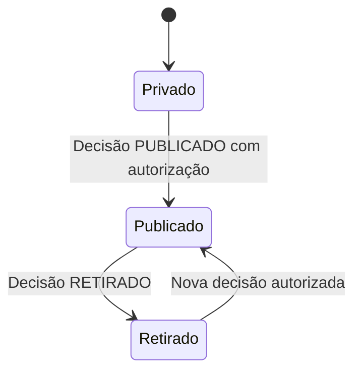

# Estados do projeto e decisões de publicação

Base `c2dbb7f`, revisão de 25/11/2026. `ProjectStatus` possui quatro valores; publicação é uma sequência separada de decisões.

Preparação permite upload antes do prazo; Ajustes dispensa o prazo original. Em avaliação bloqueia alterações de materiais e conserva o snapshot da rodada. A reabertura de uma avaliação C2 não é a devolução da entrega C1: ela mantém a rodada e reabre notas, com justificativa/histórico, tornando a liberação anterior inaplicável quando o resultado efetivo muda.

O segundo diagrama só se aplica a um projeto com decisão válida `FINALIZADO`. Publicação não modifica o enum para `PUBLICADO`; expõe apenas versões selecionadas e um DTO público. Retirada conserva os dados privados e a auditoria, mas impede novos acessos públicos aos materiais. No servidor normal, a primeira finalização/publicação está bloqueada enquanto `publicationProviders` reais não forem conectados.
